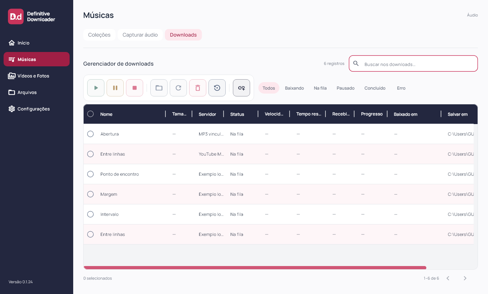

# Definitive Downloader

**D.d** é a abreviação oficial de **Definitive Downloader**, um aplicativo em Flutter/Dart para Windows e Android com foco inicial em playlists e arquivos musicais.

A [pré-release 0.1.101 para Windows](https://github.com/GustavoDevGTI/D.d---Definitive-Downloader/releases/tag/v0.1.101) reúne as correções da biblioteca, o suporte ampliado a áudio local, a conversão para MP3 e os ajustes da conexão Deezer. Confira as [notas da versão](docs/RELEASE_0_1_101.md). O desenvolvimento Android está pausado; os últimos APKs publicados estão na [0.1.95](https://github.com/GustavoDevGTI/D.d---Definitive-Downloader/releases/tag/v0.1.95).

## Histórico da interface



A versão **0.1.25** apresenta avisos em popups centrais, unifica a seleção das faixas no cabeçalho e torna o cadeado uma ajuda acionável. A fonte manual ganha contorno vinho; faixas concluídas permitem consultar o vínculo. Ouvir prévia foi removido enquanto a reprodução estiver indisponível. [Validação](docs/RELEASE_0_1_25.md).

A versão **0.1.24** compacta as larguras padrão de Downloads para mostrar todas as colunas até Baixado em na largura desktop de 1360 px; Salvar em pode continuar na rolagem horizontal. Recebido é o novo nome da coluna de volume em bytes, cuja medição permanece indisponível. [Validação](docs/RELEASE_0_1_24.md).

A versão **0.1.23** mantém um único Adicionar links, remove as setas de prioridade e inclui Resetar tabela no grupo de utilitários. A coluna Baixado em usa o histórico de conclusão e permite alternar entre mais recentes e antigos. [Validação](docs/RELEASE_0_1_23.md).

A versão **0.1.22** permite ordenar Downloads clicando em Nome, Servidor, Status e Salvar em, alternando crescente/decrescente com seta. A ordenação cobre todas as páginas do filtro, sem alterar playlist ou prioridade. O cabeçalho azul agora ocupa também a ponta junto à barra vertical. [Validação](docs/RELEASE_0_1_22.md).

A versão **0.1.21** corrige o bloco claro que aparecia na divisória ao ajustar colunas: o fundo continua azul e apenas a linha fica branca e mais espessa no foco, mantendo teclado e arraste. [Validação](docs/RELEASE_0_1_21.md).

A versão **0.1.20** restaura o cabeçalho azul-marinho `#23273F`, com texto e divisórias claros, conforme pedido posterior. Preserva o redimensionamento nos dois sentidos e as demais funções da tabela. [Validação](docs/RELEASE_0_1_20.md).

A versão **0.1.19** corrige o arraste das divisórias de Downloads nos dois sentidos: a coluna vizinha cede ou recebe espaço, mantendo as demais posições enquanto houver espaço; no mínimo da vizinha, a tabela pode crescer. O cabeçalho usa o mesmo vinho `#A01F45` do botão Músicas, com texto branco. O ajuste usa as larguras exibidas, sem compensação automática de Nome durante o gesto, e persiste o conjunto ao terminar. [Validação](docs/RELEASE_0_1_19.md).

A versão **0.1.18** clareia o cabeçalho de Downloads com rosa suave da paleta, texto grafite e seleção azul acinzentado. Mantém o cabeçalho fixo, a área ampliada e filtros vazios. [Validação](docs/RELEASE_0_1_18.md).

A versão **0.1.17** amplia a área útil de Downloads, fixa o cabeçalho azul-marinho e usa linhas alternadas em rosa suave e barras de rolagem framboesa. Filtros sem resultados mantêm a tabela vazia com cabeçalho. [Validação](docs/RELEASE_0_1_17.md).

A versão **0.1.16** acrescenta animação de escala aos controles de Downloads e Adicionar links: crescimento no hover/foco, compressão ao pressionar e retorno suave, sem deslocar os outros controles. Respeita movimento reduzido e botões desabilitados. [Validação](docs/RELEASE_0_1_16.md).

A versão **0.1.15** diferencia as cores de iniciar, pausar, parar e adicionar links, torna o hover/foco dos botões mais perceptível e permite comprimir as colunas de Downloads até 40–64 px. Reticências preservam as linhas e tooltips mostram o conteúdo completo. [Validação e capturas](docs/RELEASE_0_1_15.md).

A versão **0.1.14** permite editar nome, posição/número e link/ID de cada ocorrência antes dos downloads; ao iniciar, a coleção mantém nomes e ordem bloqueados, inclusive após reiniciar. Links extras continuam disponíveis antes e durante a execução. Spotify busca equivalentes nas outras fontes; links musicais YouTube manuais representam escolha da versão, enquanto videoclipes encontrados automaticamente só aparecem como última alternativa e exigem aprovação. [Validações e limites](docs/RELEASE_0_1_14.md).

A versão **0.1.13** reúne os comandos de Downloads em uma barra contornada com ícones coloridos, acrescenta pesquisa paginada e colunas redimensionáveis com persistência. O botão de adicionar links aparece na coleção e na fila: aceita faixas Spotify, Deezer, YouTube Music ATV e MP3 direto, preservando ocorrências e acrescentando fontes prontas ao final da execução ativa. Esta é uma entrega do piloto Windows; veja validações e limites em [RELEASE_0_1_13.md](docs/RELEASE_0_1_13.md).

A versão **0.1.12** padroniza os formulários de importação e captura de links com o mesmo painel, campo e hierarquia de ações, compartilhados entre desktop e mobile. Detalhes em [RELEASE_0_1_12.md](docs/RELEASE_0_1_12.md).

A versão **0.1.11** aplica às pastas de Arquivos o mesmo destaque das coleções: rosa suave, contorno e ícones da marca, com hover/foco vinho. Os dois usam o mesmo componente de navegação. Detalhes em [RELEASE_0_1_11.md](docs/RELEASE_0_1_11.md).

A versão **0.1.10** destaca as coleções com botões rosa suave, contorno e ícones da marca, além de hover/foco vinho com texto branco. Detalhes em [RELEASE_0_1_10.md](docs/RELEASE_0_1_10.md).

A versão **0.1.9** reduz orientações estáticas e textos repetidos: coleções sem o painel informativo de Conferência, captura com um único aviso de indisponibilidade e telas principais mais diretas. Detalhes em [RELEASE_0_1_9.md](docs/RELEASE_0_1_9.md).

A versão **0.1.8** aplica os códigos exatos da paleta oficial: rosa nas ações, vinho nos estados ativos, sidebar azul-marinho e superfícies neutras. Logo, ícones e navegação desktop/mobile seguem os mesmos tokens. Detalhes em [RELEASE_0_1_8.md](docs/RELEASE_0_1_8.md) e [PALETA_OFICIAL_0_1_8.md](docs/PALETA_OFICIAL_0_1_8.md).

A versão **0.1.7** aplica o guia de marca oficial enviado pelo usuário: símbolo D.d com seta, assinatura em grafite/framboesa e ícone próprio no app, executável, instalador e atalhos Windows. A identidade usa desenho Flutter compartilhado, SVGs e exportações PNG/ICO. Detalhes em [RELEASE_0_1_7.md](docs/RELEASE_0_1_7.md).

A versão local **0.1.6** ocupa toda a janela, traz uma identidade mais pessoal em framboesa/azul e reúne os comandos de Downloads em uma linha de ícones. O Início prioriza Coleções, Arquivos e indicadores reais sem caixas. Pesquisa, capturas e limites em [RELEASE_0_1_6.md](docs/RELEASE_0_1_6.md).

A versão local **0.1.5** reorganiza os comandos de Downloads com rótulos e espaçamento, ativa pausa e prioridade e abre a fila musical ao iniciar pela coleção. Ordem da playlist, repetições e histórico são preservados. Resultados e limites em [RELEASE_0_1_5.md](docs/RELEASE_0_1_5.md).

A versão **0.1.4** estabeleceu a referência visual desktop e mobile: dois atalhos no Início, três indicadores reais, lista vertical de coleções, captura em painéis e histórico por pastas. Resultados em [RELEASE_0_1_4.md](docs/RELEASE_0_1_4.md).

A versão local **0.1.3** aproxima a organização do HTML de referência: coleções acima da lista, painéis contornados, abas em botões e formulário de captura com espaçamento corrigido. A limpeza dos dados de teste foi feita uma única vez, com backup, preservando contas, preferências e arquivos baixados. Detalhes em [RELEASE_0_1_3.md](docs/RELEASE_0_1_3.md).

A reestruturação [Wireframe v0.5.1](docs/REESTRUTURACAO_WIREFRAME_0_5_1.md), no aplicativo 0.1.2, organiza Início, Músicas, Vídeos e Fotos, Arquivos e Configurações. Músicas reúne Coleções, Capturar Áudio e Downloads; Vídeos e Fotos reúne Capturar Mídias e Downloads. O histórico de arquivos é organizado pelas pastas em que os downloads foram salvos. A navegação inferior e a lista compacta foram preparadas para mobile; as integrações nativas mobile continuam pendentes.

Fontes manuais são persistidas por ocorrência e protegidas da busca automática. MP3 direto mantém o download existente; links musicais do YouTube passam pelo catálogo e pelo motor de áudio; páginas genéricas permanecem sem extração disponível. Captura geral, downloads de vídeos/fotos e métricas de rede continuam indisponíveis. Pausa e prioridade foram acrescentadas ao piloto Windows em 0.1.5; o motor musical mobile segue pendente.

Resultados e limites desta entrega: [primeira versão desktop](docs/PRIMEIRA_VERSAO_DESKTOP.md) e [testes sem conta](docs/TESTES_SEM_CONTA.md).

Próxima feature estudada: [transferência de playlists entre plataformas](docs/TRANSFERENCIA_DE_PLAYLISTS.md), inspirada no fluxo do TuneMyMusic e integrada ao design próprio do Definitive Downloader. A transferência remota ainda não está implementada.

O [escopo das ferramentas de playlists](docs/FERRAMENTAS_DE_PLAYLISTS.md) inclui também compartilhamento, cópia de segurança, geração com IA e organização, com entrega de uma feature por vez. Essas funções permanecem no planejamento.

O [escopo de formatos e plataformas](docs/FORMATOS_E_MULTIPLATAFORMA.md) exige também `.dlc`, `.ccf`, `.rsdf`, `.metalink`, `.meta4`, `.nzb` e `.sfdl`, além dos formatos tradicionais, tanto no desktop quanto no mobile. Esses sete formatos ainda não estão implementados ou validados.

Para importar uma playlist pública do Spotify, cole o link em **Músicas → Coleções → Importar por link**. O serviço do projeto usa CheckLeaked via RapidAPI e abre a Conferência após ler a lista. Se a playlist estiver privada, o D.d orienta como torná-la pública no Spotify. As opções de conexão pessoal Trackhop e importação por CSV também estão disponíveis. [Serviço de importação](docs/VERSAO_LOCAL_0_1_67.md) · [Conexão pessoal](docs/VERSAO_LOCAL_0_1_65.md)

## Executar

A versão 0.1.16 mantém o instalador por usuário para Windows, com atalho no menu Iniciar e desinstalador. Biblioteca e sessões ficam fora da pasta instalada e são preservadas na desinstalação. O instalador não está assinado digitalmente. Notas e limites em [RELEASE_0_1_16.md](docs/RELEASE_0_1_16.md). As versões seguintes devem avançar de forma incremental, conforme AGENTS.md.

No Windows, abra `INICIAR.cmd`. Ele atualiza o pacote em `%LOCALAPPDATA%\DefinitiveDownloader\app` e abre essa cópia local, evitando uma falha de carregamento de DLL do motor quando iniciado pelo Flutter em pasta de rede. Não abra o executável diretamente pela UNC. O executável precisa permanecer junto das DLLs e das pastas `data` e `music_engine` do pacote; contas e biblioteca usam seu armazenamento próprio.

Para compilar a partir dos fontes:

```powershell
& .\tools\build_windows.ps1 -TestAreas collections
```

O script usa um diretório de compilação local em `%LOCALAPPDATA%\DefinitiveDownloaderDev`, porque o workspace pode estar em unidade de rede sem suporte a symlinks. Ele não altera os fontes no diretório local: os fontes oficiais permanecem neste workspace. São necessários Flutter e Visual Studio Build Tools com o workload C++.

O motor musical tem build próprio: `tools/build_music_engine.ps1 -Python <python-do-ambiente-de-build>`. As dependências estão travadas em `runtime/music_worker/requirements.txt`; o build usa PyInstaller 6.16.0. O pacote final inclui o runtime e FFmpeg, sem exigir Python global no computador do usuário. Consulte o relatório da integração para reproduzir o build em workspace de rede.

## O que funciona nesta versão

- Coleções persistidas em SQLite, listagem paginada e seleção por faixa.
- Importação de CSV em stream, preservando ordem e ocorrências repetidas.
- Importação de playlists públicas do Spotify pelo serviço do D.d, com ordem e ocorrências repetidas preservadas.
- Busca integrada em Deezer e YouTube Music, comparando artista, título, duração, versão e álbum. Candidatos ambíguos exigem revisão.
- Busca automática prioriza faixas Deezer e YouTube Music ATV. Videoclipes OMV só são oferecidos em último caso, com aprovação da versão específica. Links YouTube inseridos manualmente dispensam matching/aprovação; ID, disponibilidade, duração e áudio continuam sendo validados. Não há corte de duração para ajustar outra versão.
- Conexão Deezer por sessão própria informada somente no app, guardada no cofre do sistema. Autenticação, restauração após reinício e sete arquivos completos foram confirmados neste piloto; isso não comprova todo o catálogo ou outras contas/regiões.
- MP3 com capa embutida, metadados da fonte, conferência de duração, decodificação integral e exportação M3U8 em ordem.
- Fluxos anteriores de prévia Deezer e vínculo manual de MP3 continuam distintos do novo fluxo musical.
- Exemplo local com áudio sintético: selecione as faixas e baixe para conferir arquivos reais com capa, sem conta.
- Recuperação de itens interrompidos após reiniciar; nova tentativa reinicia a transferência daquele arquivo. Itens já concluídos são preservados.

## Limites explícitos

O serviço de importação fornece os metadados da playlist. A disponibilidade do áudio é conferida faixa por faixa nas fontes de música. Uma prévia permanece identificada como prévia no arquivo e na interface.

Windows e Android compartilham a interface e as regras em Dart. O Android tem integrações nativas para áudio, transferências e armazenamento. A versão de teste é distribuída em APKs por arquitetura, com Android 7.0 ou superior. O ensaio de instalação desta versão no Android foi feito no emulador x86-64.

Os ensaios antigos com spotDL, librespot e Zotify estão em [TESTES_AUDIO_SPOTIFY.md](docs/TESTES_AUDIO_SPOTIFY.md). Esses motores não foram incorporados. A nova integração usa módulos próprios e exclui o fallback antigo para vídeos. Um ensaio anterior pelo runner Flutter gerou dez faixas YouTube Music em banco separado; a rodada posterior pela interface nativa concluiu a coleção de produção combinando Deezer e YouTube Music. As evidências distinguem as duas execuções.

Formato CSV mínimo, UTF-8, uma faixa por linha:

```csv
titulo,artista,album,duracao
Minha faixa,Meu artista,Meu álbum,180
Minha faixa,Meu artista,Meu álbum,180
```

Também aceita separador `;`, colunas `duration_ms`, `isrc`, `cover_url` e `spotify_url`, e alguns cabeçalhos de exportações Spotify. Limites: 20 MB, 10.000 faixas por coleção, 100 registros por lote e 40 linhas por página. Campos com quebras de linha dentro de aspas não são suportados.

## Estrutura

`lib/main.dart` compõe as dependências. `lib/core` contém armazenamento, rede e integrações do sistema. `lib/features` separa importação, domínio/biblioteca, matching, downloads e apresentação. `runtime/music_worker` contém adaptadores isolados por operação, chamados pelo app Windows. O banco guarda registros relacionais, nunca uma coleção inteira serializada em um campo JSON.

Responsabilidades no fluxo musical:

| Módulo | Responsabilidade |
| --- | --- |
| `library/application/library_controller.dart` | Estado da tela, seleção e coordenação dos comandos; preserva a interface usada pelas telas. |
| `library/application/library_music_sources.dart` | Conferência paginada, vínculos manuais e prévias. |
| `library/application/download_queue_run.dart` | Execução da fila, extras, alternativas autorizadas, publicação e exportação. |
| `downloads/download_cancellation.dart` e `download_file_name.dart` | Regras compartilhadas sem depender dos adaptadores de obtenção. |
| `library/data` e `workspace/data` | Consultas, transações e paginação; widgets não fazem SQL ou acesso direto ao disco. |
| `player/application`, `player/data`, `player/presentation` | Fila/estado, motor/arquivos e interface. O relógio possui notificações separadas dos controles. |

As tabelas mantêm navegação/gestos e delegam a apresentação das linhas. Progresso de transferência usa `transferUpdates`; recarga de dados usa a revisão da biblioteca. `test/architecture_test.dart` impede ciclos de importação e dependências de plataforma/SQL na apresentação e no domínio. Os testes de custo verificam notificações e consultas evitadas, sem equivaler a um benchmark de FPS.

Validação local: núcleo essencial + testes da área alterada, com `tools/test_project.ps1 -Area collections` (workspace Flutter local sincronizado). Regressão completa somente quando necessária ou antes de release: `-Profile Regression`. Divisão, comandos e critérios em [POLITICA_DE_TESTES.md](docs/POLITICA_DE_TESTES.md); regras de continuidade em [AGENTS.md](AGENTS.md).

Manrope usa SIL Open Font License; texto em `assets/fonts/OFL.txt`. O áudio e a imagem do exemplo são fixtures sintéticas criadas localmente. Dependências conservam suas licenças próprias. Nenhum código C2/JDownloader foi incorporado.
