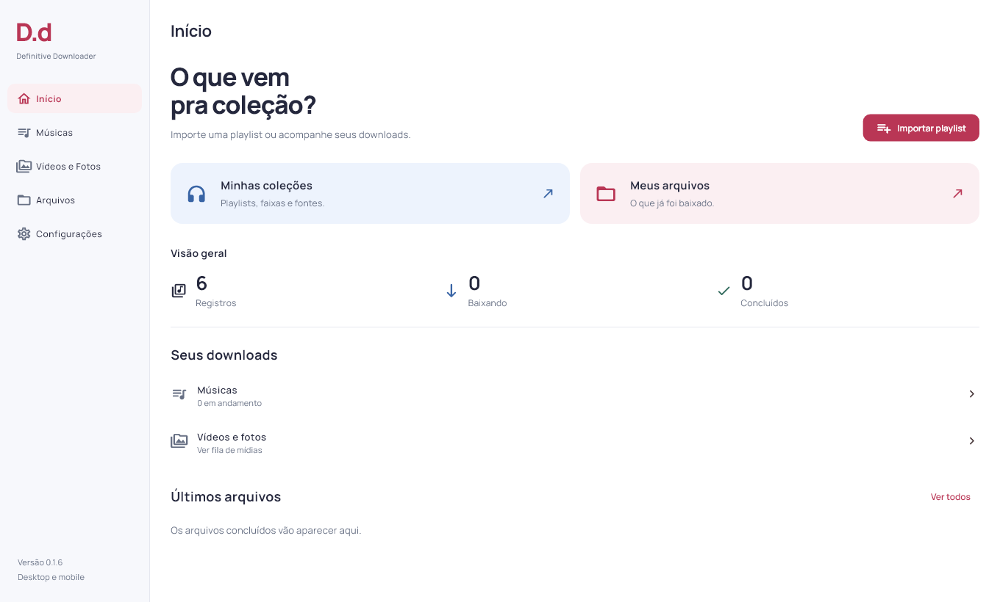

# Definitive Downloader

**D.d** é a abreviação oficial de **Definitive Downloader**, nome escolhido pelo usuário. O produto é desktop e mobile, feito em Flutter/Dart, com foco inicial em playlists e arquivos musicais. A entrega atual é um piloto Windows. Visual claro, tabelas e conferência de fontes, com identidade distinta de C2 e JDownloader.

Código e versões: [repositório do produto](https://github.com/GustavoDevGTI/D.d---Definitive-Downloader) · [release v0.1.6](https://github.com/GustavoDevGTI/D.d---Definitive-Downloader/releases/tag/v0.1.6). Cada nova versão deve ter commit, tag, notas e artefatos próprios, preservando as releases anteriores.



A versão local **0.1.6** ocupa toda a janela, traz uma identidade mais pessoal em framboesa/azul e reúne os comandos de Downloads em uma linha de ícones. O Início prioriza Coleções, Arquivos e indicadores reais sem caixas. Pesquisa, capturas e limites em [RELEASE_0_1_6.md](docs/RELEASE_0_1_6.md).

A versão local **0.1.5** reorganiza os comandos de Downloads com rótulos e espaçamento, ativa pausa e prioridade e abre a fila musical ao iniciar pela coleção. Ordem da playlist, repetições e histórico são preservados. Resultados e limites em [RELEASE_0_1_5.md](docs/RELEASE_0_1_5.md).

A versão **0.1.4** estabeleceu a referência visual desktop e mobile: dois atalhos no Início, três indicadores reais, lista vertical de coleções, captura em painéis e histórico por pastas. Resultados em [RELEASE_0_1_4.md](docs/RELEASE_0_1_4.md).

A versão local **0.1.3** aproxima a organização do HTML de referência: coleções acima da lista, painéis contornados, abas em botões e formulário de captura com espaçamento corrigido. A limpeza dos dados de teste foi feita uma única vez, com backup, preservando contas, preferências e arquivos baixados. Detalhes em [RELEASE_0_1_3.md](docs/RELEASE_0_1_3.md).

A reestruturação [Wireframe v0.5.1](docs/REESTRUTURACAO_WIREFRAME_0_5_1.md), no aplicativo 0.1.2, organiza Início, Músicas, Vídeos e Fotos, Arquivos e Configurações. Músicas reúne Coleções, Capturar Áudio e Downloads; Vídeos e Fotos reúne Capturar Mídias e Downloads. O histórico de arquivos é organizado pelas pastas em que os downloads foram salvos. A navegação inferior e a lista compacta foram preparadas para mobile; as integrações nativas mobile continuam pendentes.

Fontes manuais são persistidas por ocorrência e protegidas da busca automática. MP3 direto mantém o download existente; a opção de extração de página/vídeo registra apenas um vínculo pendente. Captura geral, downloads de vídeos/fotos e métricas de rede continuam indisponíveis. Pausa e prioridade foram acrescentadas ao piloto Windows em 0.1.5; o motor musical mobile segue pendente.

Resultados e limites desta entrega: [primeira versão desktop](docs/PRIMEIRA_VERSAO_DESKTOP.md) e [testes sem conta](docs/TESTES_SEM_CONTA.md).

Próxima feature estudada: [transferência de playlists entre plataformas](docs/TRANSFERENCIA_DE_PLAYLISTS.md), inspirada no fluxo do TuneMyMusic e integrada ao design próprio do Definitive Downloader. A transferência remota ainda não está implementada.

O [escopo das ferramentas de playlists](docs/FERRAMENTAS_DE_PLAYLISTS.md) inclui também compartilhamento, cópia de segurança, geração com IA e organização, com entrega de uma feature por vez. Essas funções permanecem no planejamento.

O [escopo de formatos e plataformas](docs/FORMATOS_E_MULTIPLATAFORMA.md) exige também `.dlc`, `.ccf`, `.rsdf`, `.metalink`, `.meta4`, `.nzb` e `.sfdl`, além dos formatos tradicionais, tanto no desktop quanto no mobile. Esses sete formatos ainda não estão implementados ou validados.

Para preparar o primeiro piloto com contas reais: [cadastro Spotify e Google](docs/CONFIGURACAO_DAS_CONTAS_DE_TESTE.md).

A conexão Spotify por PKCE permite importar a playlist de teste com 10 faixas. A integração musical pesquisa Deezer e YouTube Music dentro do D.d, com revisão de correspondências e exclusão de videoclipes. O teste nativo Windows concluiu dez MP3s: sete da Deezer com conta própria informada como gratuita e três do YouTube Music, todos com capa, duração conferida, decodificação completa e M3U8 ordenada. A conexão Deezer também foi restaurada após reiniciar. Resultados em [DOWNLOAD_MUSICAL_INTEGRADO.md](docs/DOWNLOAD_MUSICAL_INTEGRADO.md).

## Executar

A versão local 0.1.6 mantém o instalador por usuário para Windows, com atalho no menu Iniciar e desinstalador. Biblioteca e sessões ficam fora da pasta instalada e são preservadas na desinstalação. O instalador não está assinado digitalmente. Notas e limites em [RELEASE_0_1_6.md](docs/RELEASE_0_1_6.md). As versões seguintes devem avançar de forma incremental, conforme AGENTS.md.

No Windows, abra `INICIAR.cmd`. Ele atualiza o pacote em `%LOCALAPPDATA%\DefinitiveDownloader\app` e abre essa cópia local, evitando uma falha de carregamento de DLL do motor quando iniciado pelo Flutter em pasta de rede. Não abra o executável diretamente pela UNC. O executável precisa permanecer junto das DLLs e das pastas `data` e `music_engine` do pacote; contas e biblioteca usam seu armazenamento próprio.

Para compilar a partir dos fontes:

```powershell
& .\tools\build_windows.ps1
```

O script usa um diretório de compilação local em `%LOCALAPPDATA%\DefinitiveDownloaderDev`, porque o workspace pode estar em unidade de rede sem suporte a symlinks. Ele não altera os fontes no diretório local: os fontes oficiais permanecem neste workspace. São necessários Flutter e Visual Studio Build Tools com o workload C++.

O motor musical tem build próprio: `tools/build_music_engine.ps1 -Python <python-do-ambiente-de-build>`. As dependências estão travadas em `runtime/music_worker/requirements.txt`; o build usa PyInstaller 6.16.0. O pacote final inclui o runtime e FFmpeg, sem exigir Python global no computador do usuário. Consulte o relatório da integração para reproduzir o build em workspace de rede.

## O que funciona nesta versão

- Coleções persistidas em SQLite, listagem paginada e seleção por faixa.
- Importação de CSV em stream, preservando ordem e ocorrências repetidas.
- Tentativa de leitura pública de playlists Spotify, sempre identificada como parcial. Essa leitura depende do conteúdo disponibilizado pelo site e não substitui autenticação oficial.
- Conexão Spotify em módulo próprio, com sessão no cofre do sistema e importação autenticada paginada. Login real, importação de uma playlist de 10 faixas e restauração da conexão após reinício foram confirmados no Windows; veja `docs/evidencias/spotify-conta-real.md`.
- Busca integrada em Deezer e YouTube Music, comparando artista, título, duração, versão e álbum. Candidatos ambíguos exigem revisão.
- YouTube Music aceita apenas faixas de catálogo do tipo `MUSIC_VIDEO_TYPE_ATV`, reconferidas antes do download. Videoclipes e busca genérica de vídeos são excluídos.
- Conexão Deezer por sessão própria informada somente no app, guardada no cofre do sistema. Autenticação, restauração após reinício e sete arquivos completos foram confirmados neste piloto; isso não comprova todo o catálogo ou outras contas/regiões.
- MP3 com capa embutida, metadados da fonte, conferência de duração, decodificação integral e exportação M3U8 em ordem.
- Fluxos anteriores de prévia Deezer e vínculo manual de MP3 continuam distintos do novo fluxo musical.
- Exemplo local com áudio sintético: selecione as faixas e baixe para conferir arquivos reais com capa, sem conta.
- Recuperação de itens interrompidos após reiniciar; nova tentativa reinicia a transferência daquele arquivo. Itens já concluídos são preservados.

## Limites explícitos

O login Spotify foi acrescentado ao piloto Windows; Google OAuth para escrever playlists e o retorno de login mobile ainda não foram configurados. A busca/download de áudio do YouTube Music usa um adaptador próprio sem conta. Não há áudio direto do Spotify validado. A disponibilidade Deezer continua sendo conferida faixa por faixa. Uma prévia permanece identificada como prévia no arquivo e na interface.

Uma falha TLS anterior no servidor de login Spotify foi resolvida utilizando também as raízes públicas já confiadas pelo Windows, sem desativar validação de certificados.

A base de UI e regras usa Dart compartilhável. O alvo compilado nesta entrega é Windows. A navegação e as telas compactas foram verificadas em testes de widgets; os pacotes e as integrações nativas mobile ainda não foram implementados ou validados.

Os ensaios antigos com spotDL, librespot e Zotify estão em [TESTES_AUDIO_SPOTIFY.md](docs/TESTES_AUDIO_SPOTIFY.md). Esses motores não foram incorporados. A nova integração usa módulos próprios e exclui o fallback antigo para vídeos. Um ensaio anterior pelo runner Flutter gerou dez faixas YouTube Music em banco separado; a rodada posterior pela interface nativa concluiu a coleção de produção combinando Deezer e YouTube Music. As evidências distinguem as duas execuções.

Formato CSV mínimo, UTF-8, uma faixa por linha:

```csv
titulo,artista,album,duracao
Minha faixa,Meu artista,Meu álbum,180
Minha faixa,Meu artista,Meu álbum,180
```

Também aceita separador `;`, colunas `duration_ms`, `isrc`, `cover_url` e `spotify_url`, e alguns cabeçalhos de exportações Spotify. Limites: 20 MB, 10.000 faixas por coleção, 100 registros por lote e 40 linhas por página. Campos com quebras de linha dentro de aspas não são suportados.

## Estrutura

`lib/main.dart` compõe as dependências. `lib/core` contém armazenamento, rede e integrações do sistema. `lib/features` separa importação, domínio/biblioteca, matching, downloads e apresentação. `runtime/music_worker` contém adaptadores isolados por operação, chamados pelo app Windows. O banco guarda registros relacionais, nunca uma coleção inteira serializada em um campo JSON.

Validação: `dart format`, `flutter analyze` e `flutter test`. Regras de continuidade em [AGENTS.md](AGENTS.md); análise original, decisões e resultados em [docs/](docs/).

Manrope usa SIL Open Font License; texto em `assets/fonts/OFL.txt`. O áudio e a imagem do exemplo são fixtures sintéticas criadas localmente. Dependências conservam suas licenças próprias. Nenhum código C2/JDownloader foi incorporado.
