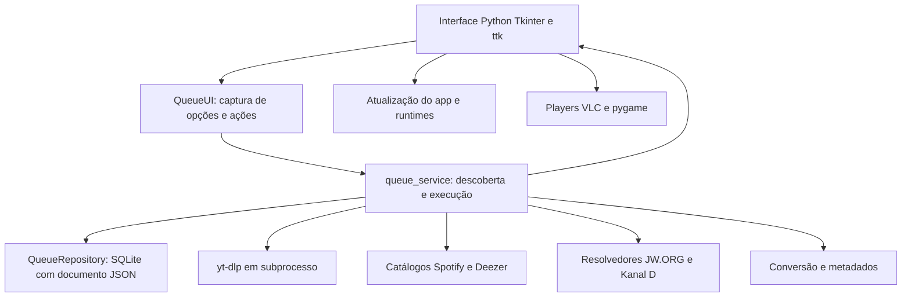
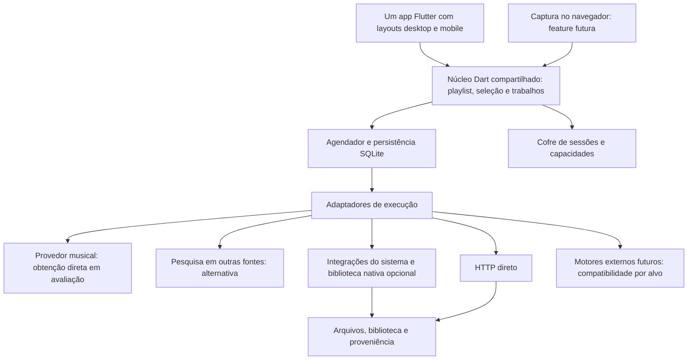
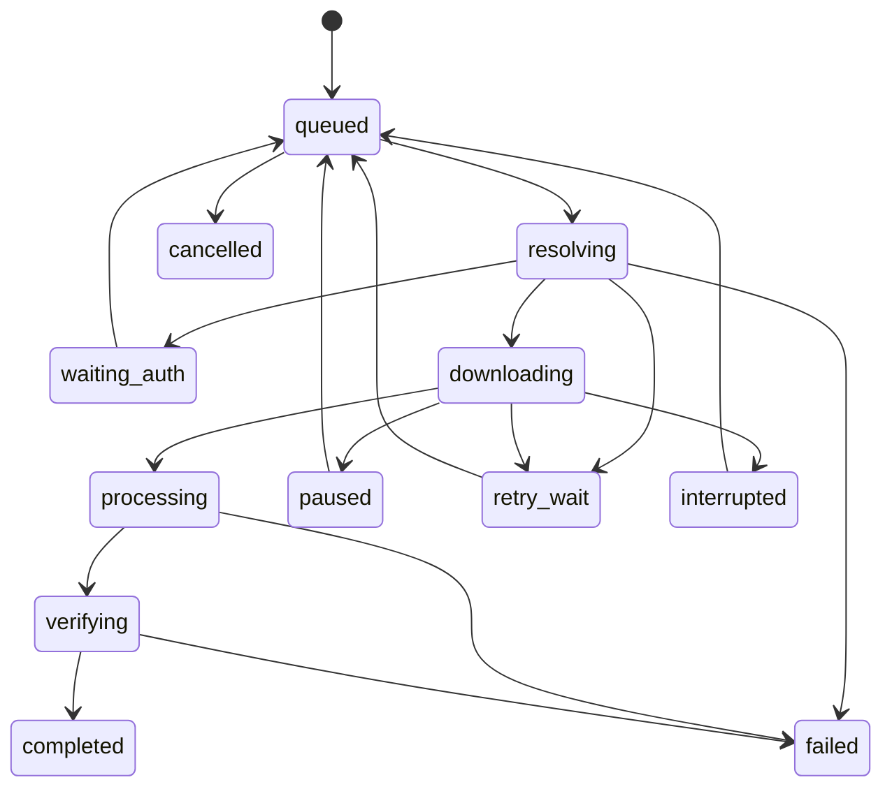

# Avaliação do C2 Video Downloader e projeto estrutural do novo downloader

Data da análise: 27/10/2026. Este documento registra a avaliação e a proposta inicial.

**Situação atual, reafirmada em 28/10/2026:** Flutter/Dart está confirmado e o produto é desktop e mobile. O piloto Windows foi implementado; consulte [a entrega desktop](PRIMEIRA_VERSAO_DESKTOP.md) e [os testes sem conta](TESTES_SEM_CONTA.md). Mobile ainda não foi entregue ou validado; isso é uma lacuna da entrega, não uma redução do escopo. Novas features devem contemplar desktop e mobile na mesma etapa. Referências abaixo à escolha de framework ainda em discussão são históricas. O [escopo de formatos e plataformas](FORMATOS_E_MULTIPLATAFORMA.md) acrescenta os sete formatos solicitados pelo usuário como requisitos do produto, ainda pendentes de implementação e validação.

Diretrizes confirmadas pelo usuário após a avaliação: identidade visual própria, diferente de C2 e JDownloader; playlists do Spotify como primeira feature; pesquisa e conferência de faixas em outras plataformas dentro do app; desenvolvimento de cada feature em desktop e mobile na mesma etapa. As recomendações iniciais de desktop primeiro e música em fase posterior foram substituídas nas seções de planejamento abaixo.

Prioridade de pesquisa acrescentada: avaliar primeiro obtenção direta do Spotify e o efeito de autenticação Premium. O usuário também propôs um app único com stack compartilhada; a recomendação revisada é compartilhar interface e núcleo de regras, deixando somente integrações do sistema específicas. É uma proposta técnica em discussão, não uma escolha de framework já aprovada.

## 1. Parecer executivo

É viável construir um produto próprio com cobertura ampla de vídeos, imagens, áudio e arquivos. O ativo principal será a combinação de descoberta de mídia, integrações por site, execução confiável e atualização contínua dos extratores. Não existe uma combinação de C2 e JDownloader que assegure download de qualquer conteúdo da internet.

O C2 é uma base funcional de experiência e de partes do processamento no Windows. O JDownloader é uma referência mais madura para coleta de links, plugins por site, contas, pacotes e agendamento. Minha recomendação é preservar o conhecimento e os módulos aproveitáveis do C2, desenvolver um núcleo independente da interface e admitir o JDownloader como motor externo opcional. Não recomendo fundir os dois projetos nem transformar o aplicativo em uma interface dependente exclusivamente do JDownloader.

O primeiro objetivo é o fluxo completo de uma playlist do Spotify. Antes de adotar correspondência com outras fontes como caminho principal, avaliar a obtenção direta e o alcance real de uma conta Premium. Se não houver um caminho viável para os arquivos pretendidos, usar pesquisa de correspondências dentro do app, conferência e seleção dos resultados. Desktop e mobile devem percorrer o fluxo na mesma entrega. Vídeo, imagens, stories, varredura de páginas e JD2 ficam para features posteriores.

Flutter/Dart passa a ser a proposta para interface e núcleo de regras compartilhados, incluindo playlist, seleção, correspondência, fila e histórico. Python não é mais a recomendação de núcleo obrigatório; eventual motor de terceiros fica atrás de um adaptador e deve ser validado nas plataformas pretendidas. O modo pareado é uma alternativa técnica, não uma exigência aprovada nem substituto automático de download no celular. Sistemas operacionais mobile de lançamento ainda precisam ser definidos. No iOS, segundo plano e publicação exigem uma estratégia própria.

Spotify deve ser dividido em importação de catálogo e obtenção de áudio. A interface oficial fornece metadados e não oferece download das faixas completas como arquivos. Correspondência com outra fonte é uma operação diferente, com requisitos próprios de autorização, precisão e identificação da procedência. Deezer é candidata para pesquisa e correspondência; pesquisa de catálogo não comprova disponibilidade de download de áudio completo.

## 2. Escopo e evidências

### 2.1 Fotografia do C2

- Repositório: [Jjunior-san/C2-VIDEODOWNLOADER](https://github.com/Jjunior-san/C2-VIDEODOWNLOADER).
- Branch analisada: `main`.
- Commit: [`d34ba9b312fdcd12ed78f308237630857f8ae0a7`](https://github.com/Jjunior-san/C2-VIDEODOWNLOADER/commit/d34ba9b312fdcd12ed78f308237630857f8ae0a7).
- Versão declarada e último release consultado: [v2.5.0](https://github.com/Jjunior-san/C2-VIDEODOWNLOADER/releases/tag/v2.5.0), publicado em 14/10/2026.
- Consulta pública à API do GitHub confirmou o release apontando para esse commit e licença não identificada.
- Foram examinados os módulos de execução, fila, Spotify, Deezer, atualização, conversão, players, resolvedores específicos, testes e workflows. Recursos visuais e cada função de interface não receberam auditoria individual.

O repositório foi clonado em diretório temporário para leitura e execução da suíte existente. Não foi modificado no GitHub e nenhum programa de download foi implementado no workspace. Os arquivos nesta pasta são documentação e evidência da avaliação.

### 2.2 Verificação executada

Em ambiente virtual temporário no Windows, com Python 3.12.14, pytest 9.1.1 e yt-dlp 2026.10.26:

```text
178 passed, 59 skipped, 4 subtests passed in 40.13s
```

O projeto configura Python 3.13 no CI; portanto esta execução local não reproduz exatamente o ambiente oficial. O runtime disponível não conseguiu inicializar Tk por falta de `init.tcl`. Os testes de interface que dependem dele foram ignorados. A execução não valida aparência, usabilidade ou funcionamento real da janela. Os 59 casos ignorados não devem ser contabilizados como aprovados. Registro: [resultado da suíte](evidencias/resultado-testes-c2.txt).

Também consultei o resultado público dos workflows do commit: [CI](https://github.com/Jjunior-san/C2-VIDEODOWNLOADER/actions/runs/38519735202) e [build/release](https://github.com/Jjunior-san/C2-VIDEODOWNLOADER/actions/runs/38519735196), ambos reportados como concluídos com sucesso na consulta. Isso não substitui auditoria dos instaladores.

Foram feitas três verificações adicionais sem contas reais nem downloads de plataformas: correspondência musical com respostas simuladas, reconhecimento de link curto e persistência de token fictício. O resultado está em [reproduções](evidencias/reproducoes-c2.txt).

### 2.3 Profundidade da avaliação do JDownloader

Usei documentação oficial de desenvolvimento, coleta, autenticação e MyJDownloader, além de leitura de classes em um espelho público do código: `LinkCrawler`, `LinkCollector`, `DownloadWatchDog`, `PluginForHost`, `PluginForDecrypt` e `TwitterComCrawler`.

O acesso HTTPS direto aos arquivos tentado no SVN oficial retornou 401. O guia oficial indica acesso via SVN. O espelho é evidência complementar de estrutura; não foi autenticado contra uma revisão atual do SVN. Não compilei nem executei o JDownloader e não fiz teste de cobertura real de cada plugin. Portanto, esta é uma avaliação de arquitetura e integração, não uma certificação de funcionamento das plataformas na versão instalada de JD2.

Fontes: [guia oficial atualizado](https://support.jdownloader.org/en/knowledgebase/article/setup-ide-eclipse), [PluginForHost no espelho](https://github.com/mirror/jdownloader/blob/master/src/jd/plugins/PluginForHost.java), [PluginForDecrypt no espelho](https://github.com/mirror/jdownloader/blob/master/src/jd/plugins/PluginForDecrypt.java).

## 3. O que o C2 já entrega

### 3.1 Arquitetura observada



O retorno de `queue_service` para métodos do objeto da interface é o principal acoplamento a remover. Há extração parcial da lógica para módulos, mas ainda não existe um núcleo consumível por desktop, celular e terminal de forma independente.

### 3.2 Pontos positivos

| Área | Evidência | Valor para o novo produto |
|---|---|---|
| Execução por item | `queue_service.run_queue` | Falha de uma mídia pode ser tratada sem descartar o lote |
| Persistência e recuperação | `download_queue.py` | Downloads ativos são recuperados como interrompidos após fechamento |
| Controle de processos | `download_control.py`, `process_monitor.py` | Cancelamento, pausa, acompanhamento e tratamento de inatividade |
| Transferência direta | `jw_org_downloader.download_item` | Arquivos parciais, Range/If-Range, validadores e renomeação final |
| Pós-processamento | `media_conversion.py`, `audio_library.py` | Conversão, progresso, organização e metadados |
| URLs temporárias | Tratamento de Kanal D em `queue_service` | Atualização de link de mídia na retomada |
| Distribuição Windows | PyInstaller, Inno Setup e workflows | Processo de empacotamento e release já estabelecido |
| Testes | `tests/` e integração com servidor HTTP local | Casos úteis de retomada, cancelamento e expansão de playlist |

Referências do código: [fila](https://github.com/Jjunior-san/C2-VIDEODOWNLOADER/blob/d34ba9b312fdcd12ed78f308237630857f8ae0a7/download_queue.py), [controle](https://github.com/Jjunior-san/C2-VIDEODOWNLOADER/blob/d34ba9b312fdcd12ed78f308237630857f8ae0a7/download_control.py), [transferência direta](https://github.com/Jjunior-san/C2-VIDEODOWNLOADER/blob/d34ba9b312fdcd12ed78f308237630857f8ae0a7/jw_org_downloader.py#L373), [testes de integração](https://github.com/Jjunior-san/C2-VIDEODOWNLOADER/blob/d34ba9b312fdcd12ed78f308237630857f8ae0a7/tests/test_downloader_integration.py).

### 3.3 Limitações e achados

As prioridades abaixo expressam impacto no produto pretendido. Não são alegações de exploração remota demonstrada.

| ID | Prioridade | Achado e evidência | Consequência estrutural |
|---|---|---|---|
| C2-01 | Alta | `youtube_downloader_app.py` tem 5.546 linhas e reúne UI, comandos, preferências, players e coordenação | Mudanças e migração mobile exigem separar regras de produto da interface |
| C2-02 | Alta | `run_queue(owner, ...)` chama métodos da UI, acessa atributos e publica em sua fila de eventos | Novo executor deve receber dependências explícitas e emitir eventos próprios |
| C2-03 | Alta | `save_user_settings` serializa `deezer_arl` em JSON; opções da fila também incluem esse valor | Usar cofre do sistema e persistir somente referência de sessão |
| C2-04 | Alta | `match_spotify_track_to_deezer` aceita resultado por trecho do título e pode retornar o primeiro candidato sem correspondência; não verifica artista/duração nesse fallback | Separar identidade musical, candidatos, confiança e fonte efetiva |
| C2-05 | Alta | A mesma função pode alterar `explicit=False` do candidato para `True` com base na faixa solicitada | Metadados da solicitação e do arquivo obtido precisam permanecer distintos |
| C2-06 | Alta | `THIRD_PARTY_NOTICES.md` afirma ausência de ARL e descriptografia; `deezer_auth.py` e `run_queue` contêm esse fluxo | Revisar documentação e decidir expressamente o escopo antes de redistribuir |
| C2-07 | Alta | Não encontrei licença do código principal nos arquivos versionados; API do GitHub retorna licença nula | Reuso do código depende de titularidade ou autorização; repositório público não resolve isso |
| C2-08 | Média/alta | `QueueRepository` guarda a fila inteira em um único JSON numa linha SQLite e a regrava nas alterações | Não é banco corrompido por definição, mas limita escala, consultas, concorrência e múltiplos trabalhos |
| C2-09 | Média/alta | Bootstrap de componentes usa HTTPS; hashes do Deno/instalador são condicionais; manifesto não tem validação criptográfica própria no cliente | Exigir integridade/autenticidade, versões compatíveis e recuperação de atualização |
| C2-10 | Média | Dependências têm limites inferiores sem lock; CI instala yt-dlp atualizado; build publica sobre o mesmo asset com `--clobber` | Mesmo código pode gerar distribuições diferentes; releases devem ser reproduzíveis e rastreáveis |
| C2-11 | Média | Integração Spotify lê `__NEXT_DATA__` do embed e não implementa paginação de catálogo oficial | A lista pode ser incompleta e o parser depende de estrutura privada de página |
| C2-12 | Média | `spotify.link` consta entre hosts, mas o parser exige caminho de track/album/playlist e não expande o link curto | Normalização e resolução de redirecionamentos precisam de módulo próprio |
| C2-13 | Alta para o escopo | Não identifiquei varredor genérico de imagens/DOM/rede, extensão ou navegador renderizado | Requisito de varrer qualquer página exige descoberta adicional |
| C2-14 | Alta para mobile | Executáveis `.exe`, paths Windows, empacotamento Inno e integração VLC/Win32 fazem parte da solução | O código atual não constitui um app mobile portável |

Referências: [execução e roteamento](https://github.com/Jjunior-san/C2-VIDEODOWNLOADER/blob/d34ba9b312fdcd12ed78f308237630857f8ae0a7/queue_service.py#L278), [preferências](https://github.com/Jjunior-san/C2-VIDEODOWNLOADER/blob/d34ba9b312fdcd12ed78f308237630857f8ae0a7/youtube_downloader_app.py#L4447), [captura de opções](https://github.com/Jjunior-san/C2-VIDEODOWNLOADER/blob/d34ba9b312fdcd12ed78f308237630857f8ae0a7/queue_ui.py#L715), [atualização](https://github.com/Jjunior-san/C2-VIDEODOWNLOADER/blob/d34ba9b312fdcd12ed78f308237630857f8ae0a7/c2_update.py), [notas de terceiros](https://github.com/Jjunior-san/C2-VIDEODOWNLOADER/blob/d34ba9b312fdcd12ed78f308237630857f8ae0a7/THIRD_PARTY_NOTICES.md), [workflow de release](https://github.com/Jjunior-san/C2-VIDEODOWNLOADER/blob/d34ba9b312fdcd12ed78f308237630857f8ae0a7/.github/workflows/build-release.yml).

#### Reprodução da correspondência incorreta

Foi solicitado um objeto de faixa `Original Artist / Original Song`, com 240 segundos e marca explícita. Uma resposta de busca simulada retornou apenas `Different Artist / Different Song`, com 80 segundos e marca não explícita. A função devolveu esse candidato e alterou a marca para explícita. Nenhuma rede ou conta foi usada.

Isso demonstra um erro de correção do resultado, independentemente de problemas externos dos sites. Mesmo quando ISRC está disponível, ele deve ser tratado como evidência forte de identidade, e não como garantia de qualidade, arquivo bit a bit idêntico, autorização de download ou acerto de todos os metadados.

Fonte: [correspondência Spotify/Deezer](https://github.com/Jjunior-san/C2-VIDEODOWNLOADER/blob/d34ba9b312fdcd12ed78f308237630857f8ae0a7/spotify_catalog.py#L367).

#### O fluxo Spotify real

1. Tenta ler metadados do embed público.
2. Tenta um fallback para yt-dlp e depois repete a leitura de embed em caso de falha.
3. Procura a faixa na Deezer por ISRC ou busca textual.
4. O roteamento pode gerar prévia Deezer, fluxo completo com ARL ou busca no YouTube, conforme resultado e opções.

Não há obtenção do arquivo musical completo original do Spotify nesse caminho. O fallback para yt-dlp também não é uma solução de catálogo confiável: na versão 2026.10.26 instalada para avaliação, links de faixa e playlist Spotify foram reconhecidos por `KnownDRMIE`, não por um extrator especializado de playlist. Isso foi verificado por seleção de extratores, sem tentar baixar mídia.

Fontes: [resolvedor Spotify do C2](https://github.com/Jjunior-san/C2-VIDEODOWNLOADER/blob/d34ba9b312fdcd12ed78f308237630857f8ae0a7/spotify_catalog.py#L341), [descoberta do C2](https://github.com/Jjunior-san/C2-VIDEODOWNLOADER/blob/d34ba9b312fdcd12ed78f308237630857f8ae0a7/queue_service.py#L185), [classificação de sites não suportados pelo yt-dlp](https://github.com/yt-dlp/yt-dlp/blob/master/yt_dlp/extractor/unsupported.py).

### 3.4 O que reaproveitar

Reaproveitamento técnico é condicionado aos direitos sobre o código.

| Destino | Material do C2 |
|---|---|
| Preservar e adaptar | Casos de teste de retomada, controle de processos, progresso de conversão, conceitos de organização de arquivos |
| Extrair atrás de interface própria | Invocação yt-dlp, processamento FFmpeg, resolvedores JW.ORG/Kanal D, aplicação de metadados |
| Redesenhar | Persistência da fila, regras de seleção musical, autenticação, atualização e coordenação de execução |
| Usar como referência de produto | Preferências, seleção de qualidade, detalhes de mídia, fila e histórico |
| Substituir na estratégia multiplataforma | UI Tkinter, instalador exclusivo Windows e dependência da UI para executar trabalhos |
| Não transportar automaticamente | Fluxos autenticados de extração de streaming, nomes/promessas de fidelidade e documentos desatualizados |

## 4. O que aprender com o JDownloader 2

### 4.1 Separações úteis

O desenho observável distingue coleta e resolução de links, organização dos candidatos, execução de downloads e regras específicas dos hosts. Plugins de crawler podem transformar uma página em vários itens; plugins de host lidam com informações e obtenção de arquivos. Essa divisão é o aprendizado mais valioso para o novo produto.

Na leitura complementar do código, `PluginForDecrypt` expõe `decryptIt` e controle de instâncias; `PluginForHost` expõe informações do arquivo e regras de simultaneidade. O nome “decrypter” do crawler não significa que sua função genérica seja quebrar DRM. As classes dependem do ecossistema Java/AppWork/JDownloader e não são plugins independentes copiáveis para Python ou Dart.

Fontes: [tipos de plugins, documentação oficial](https://support.jdownloader.org/en/knowledgebase/article/list-of-supported-websites-plugins), [PluginForDecrypt](https://github.com/mirror/jdownloader/blob/master/src/jd/plugins/PluginForDecrypt.java), [PluginForHost](https://github.com/mirror/jdownloader/blob/master/src/jd/plugins/PluginForHost.java).

| Ideia do JD2 | Aplicação no nosso desenho |
|---|---|
| LinkGrabber separado dos downloads | Encontrar, revisar e selecionar antes de transferir |
| Crawler separado de hoster | Descoberta e execução com contratos distintos |
| Pacotes e propriedades | Coleções com ordem, origem e destino preservados |
| Regras por host/conta | Concorrência e limites ajustados ao provedor |
| Gerenciamento de sessões | Login necessário e sessão expirada como estados explícitos |
| Atualização de integrações | Corrigir um provedor sem redesenhar o aplicativo |
| Controle remoto | Celular pode acompanhar um executor em outro equipamento |

### 4.2 O que o JD2 não resolve sozinho

A documentação oficial reconhece plugins inexistentes ou quebrados e limitações de coleta em sites com conteúdo dinâmico. Ela recomenda regras e ferramentas do navegador em cenários apropriados. Logo, JD2 não fornece uma varredura universal garantida nem elimina a necessidade de descoberta no navegador.

Fonte: [coleta em sites não suportados](https://support.jdownloader.org/en/knowledgebase/article/collect-and-download-links-from-unsupported-websites).

### 4.3 Três formas de usar como base

| Estratégia | Benefício | Custo e risco | Parecer |
|---|---|---|---|
| Inspirar o desenho e implementar módulos próprios | Controle de experiência, contrato e evolução | Construir e manter nossos adaptadores | Base principal recomendada |
| Integrar um JD2 separado | Aproveitar hosts, contas e sua execução | Runtime Java, mapeamento de estados, conta/protocolo MyJDownloader e dependência externa | Opcional, depois do núcleo próprio |
| Fazer fork ou incorporar classes/plugins | Acesso profundo ao comportamento | Ecossistema Java, acoplamentos, licença e manutenção de fork | Não recomendado como ponto de partida |

A interface MyJDownloader documenta coleta, consulta de links, pacotes, início, pausa e parada. Sua comunicação envolve autenticação e criptografia; não é correto tratar JD2 como se disponibilizasse automaticamente um servidor REST local simples. Para um protótipo de integração, usar o protocolo/cliente documentado e mapear recursos explicitamente. Conectividade direta, disponibilidade do serviço e necessidade de conta devem ser verificadas no ambiente escolhido.

Fonte: [MyJDownloader — documentação](https://my.jdownloader.org/developers/index.html). Modo sem interface é documentado em [uso headless](https://support.jdownloader.org/en/knowledgebase/article/hints-for-headless).

O adaptador JD deve criar pacotes identificados, manter relação entre IDs externos e internos e reconciliar estados após reconexão. Quando JD executa o trabalho, ele controla sua transferência. Nosso agendador representa o trabalho e aplica apenas os controles suportados; não deve competir com o agendador interno do JD.

Não depender da possibilidade de extrair uma URL final do JD para baixar em outro motor: ela pode exigir conta, cabeçalhos, sessão, tempo de validade ou execução específica do plugin.

### 4.4 Licenciamento e distribuição

O site oficial publica GPLv3, e os cabeçalhos examinados das classes indicam GPLv3 ou posterior. Isso é evidência de licença desses arquivos, não uma declaração de que todos os artefatos e dependências do produto têm uma única licença. Incorporar ou modificar código requer cumprir as condições aplicáveis. Executar em processo separado não deve ser apresentado como uma isenção automática de obrigações.

Fontes: [licença publicada pelo JD](https://jdownloader.org/gpl), [cabeçalho das classes](https://github.com/mirror/jdownloader/blob/master/src/jd/plugins/PluginForHost.java). Para C2, a ausência de licença identificada deve ser resolvida com o titular: [orientação do GitHub](https://docs.github.com/en/repositories/managing-your-repositorys-settings-and-features/customizing-your-repository/licensing-a-repository).

## 5. Requisitos do produto e viabilidade

### 5.1 Significado operacional de “baixar tudo”

Definir a meta como: identificar e baixar a maior variedade de mídias e arquivos acessíveis ao usuário, com uma matriz de capacidades testadas e limitações visíveis.

Cobertura deve ser descrita por domínio, tipo de URL, tipo de mídia, autenticação, executor e data de verificação. Um domínio “suportado” para vídeos públicos não implica suporte a stories, fotos, conteúdo privado ou todas as coleções daquele domínio.

| Caso solicitado | Caminho proposto | Limitação que deve aparecer no produto |
|---|---|---|
| Vídeo ou áudio em site conhecido | Extrator especializado e motor yt-dlp | Varia por site e tipo de link; lista de suporte não é garantia |
| Fotos e carrosséis | gallery-dl e metadados de coleção | Pode exigir sessão; original pode não estar disponível |
| Fotos/vídeos em página comum | HTML, metadados, DOM renderizado e observação de rede | Só encontra o que foi publicado ou carregado no escopo observado |
| Playlist de vídeos | Crawler do provedor com paginação | Indisponíveis devem permanecer identificados no resultado |
| Stories do Instagram | Adaptador de coleção com sessão e seleção de item | Story expirado ou inacessível não pode ser prometido; link de um item não deve virar download oculto de todos |
| Mídia de X/Twitter | Adaptador para fotos, vídeos e múltiplos anexos | Conteúdo protegido requer acesso; mudanças no site podem quebrar o extrator |
| Playlist Spotify | Importar metadados; resolver fontes elegíveis separadamente | Não é download de áudio original do Spotify; catálogo também tem restrições de acesso |
| HLS/DASH | Resolver manifesto, selecionar faixas e juntar segmentos | Não garantir download quando depende de DRM ou licenciamento restrito |
| PDF, ZIP, documentos e outros arquivos diretos | Transferência HTTP com retomada | Adicionar tipo de arquivo não cria suporte a todo protocolo ou site |
| Live | Adaptador com início, duração e parada definidos | Gravar daqui em diante difere de recuperar a transmissão passada |

Fontes de capacidade: [yt-dlp](https://github.com/yt-dlp/yt-dlp), [aviso de suporte dos extratores](https://github.com/yt-dlp/yt-dlp/blob/master/supportedsites.md), [gallery-dl — sites e tipos de coleção](https://github.com/mikf/gallery-dl/blob/master/docs/supportedsites.md).

Fora da promessa geral: burlar acesso, recuperar mídia removida sem outra cópia, contornar DRM, reconstruir áudio de uma assinatura como arquivo original, obter conteúdo nunca disponibilizado ao usuário. Formatos e protocolos adicionais entram no catálogo de capacidades conforme validação, sem obrigação de implementar torrents, FTP ou todos os serviços de armazenamento no MVP.

### 5.2 Spotify: contrato de produto separado

A documentação oficial veda facilitar download de conteúdo Spotify/stream ripping. O desenho de produto deve distinguir: importar dados de uma playlist, reproduzir por mecanismos oficiais e baixar um arquivo de uma fonte que autorize isso. Não considerar que assinatura Premium ou posse de metadados concede exportação de arquivos de áudio.

Fonte: [notas oficiais no endpoint de playlist](https://developer.spotify.com/documentation/web-api/reference/get-playlist).

Para importação, prever OAuth com PKCE em clientes públicos, paginação, itens locais/indisponíveis, ordem, snapshot e permissões. A documentação atual restringe os itens retornados por `Get Playlist` às playlists próprias ou colaborativas. Não prometer importação oficial de qualquer playlist pública. Manter importação de arquivo fornecido pelo usuário como entrada adicional, sem descrevê-la como contorno das regras do provedor.

As mudanças de fevereiro de 2026 alteraram endpoints para `/items`; em março houve reversão da retirada de `external_ids`; em julho as cotas de desenvolvimento passaram a ser compartilhadas por conta de desenvolvedor. Uma especificação baseada apenas em exemplos antigos já nasce desatualizada. Fontes: [fevereiro](https://developer.spotify.com/documentation/web-api/references/changes/february-2026), [março](https://developer.spotify.com/documentation/web-api/references/changes/march-2026), [julho](https://developer.spotify.com/documentation/web-api/references/changes/july-2026), [cotas](https://developer.spotify.com/documentation/web-api/concepts/quota-modes).

Se houver correspondência com fontes independentes elegíveis, guardar `requested_track`, `candidate`, `actual_source`, duração, versão, confiança e justificativa. Comparar artista, título, duração, edição, ISRC e indicadores de live/remix/cover. Usar limiar calibrado em conjunto de avaliação; ambiguidade pede escolha. Nunca converter automaticamente uma prévia em “faixa completa” nem apresentar transcodificação de fonte com perdas como ganho de qualidade lossless. A conformidade desse fluxo precisa de avaliação específica; trocar de origem não a garante.

### 5.3 Obtenção direta do Spotify e conta Premium

Esta é a primeira investigação funcional solicitada. Separar três resultados diferentes: acesso ao catálogo, reprodução autenticada e arquivo completo exportável. O sucesso dos dois primeiros não comprova o terceiro.

| Caminho | Evidência consultada | Conclusão atual |
|---|---|---|
| Offline oficial com Premium | O suporte Spotify documenta download e reprodução offline no cliente Spotify | Não fornece ao nosso app um arquivo musical independente |
| SDKs oficiais | Web Playback SDK requer Premium para streaming; Android/iOS interagem com reprodução no app Spotify | Login Premium não habilita uma interface pública de exportação |
| Cliente não oficial librespot | O projeto se descreve como biblioteca de reprodução/Spotify Connect e declara exigir Premium | Evidência de cliente alternativo; não certifica download de playlists como arquivos nem suporte mobile pronto |
| Projeto Zotify | O README declara download diretamente da fonte | Alegação a avaliar, não capacidade atual validada nesta análise |
| spotDL | O README explica que localiza áudio no YouTube a partir de faixas Spotify | Referência para correspondência externa; não resolve obtenção direta |

Fontes: [offline oficial](https://support.spotify.com/us/article/listen-offline/), [Web Playback SDK](https://developer.spotify.com/documentation/web-playback-sdk/tutorials/getting-started), [Android SDK](https://developer.spotify.com/documentation/android), [iOS SDK](https://developer.spotify.com/documentation/ios), [librespot](https://github.com/librespot-org/librespot), [Zotify](https://github.com/zotify-dev/zotify), [spotDL](https://github.com/spotDL/spotify-downloader).

Na consulta pública ao GitHub em 27/10/2026, librespot não estava arquivado e apresentava atividade em 21/10/2026; o repositório GitHub do Zotify não estava arquivado e tinha último push em 18/09/2024. O README deste último referencia hospedagem externa, portanto a data do GitHub não permite concluir abandono do projeto inteiro. Não houve login, execução desses clientes ou validação de extração. As declarações antigas de qualidade e autenticação não foram adotadas como capacidade atual.

Conclusão: não há caminho oficial documentado para exportar áudio completo só por entrar com Premium. Há projetos não oficiais que justificam investigação técnica adicional, sem confundir sua existência com confiabilidade, autorização ou distribuição viável. A política oficial proíbe facilitar download/stream ripping; uma licença de código de terceiro não concede direitos sobre o catálogo. Fonte: [notas oficiais](https://developer.spotify.com/documentation/web-api/reference/get-playlist).

Critérios para a avaliação seguinte: origem efetiva do áudio, autenticação atual, arquivo completo e qualidade real, tratamento de catálogo indisponível, confiabilidade em playlists, dependências, suporte às plataformas de lançamento, armazenamento seguro da sessão e condições de uso/distribuição. Enquanto isso, representar a capacidade direta como não validada e manter a correspondência externa como alternativa.

## 6. Arquitetura proposta

### 6.1 Decisões iniciais

A recomendação revisada prioriza um app multiplataforma com núcleo compartilhado. O reaproveitamento de C2 deixa de determinar a linguagem central. A interface do módulo de provedor deve funcionar da mesma forma para os chamadores, mesmo quando sua implementação precisar de integração nativa. Na primeira feature, ativar somente os módulos necessários ao fluxo musical e validar as duas plataformas em conjunto.

| Tema | Recomendação | Justificativa e custo |
|---|---|---|
| Interface desktop/mobile | Flutter/Dart, proposta | Identidade compartilhada com layouts adaptativos e builds por plataforma |
| Núcleo de regras | Pacotes Dart compartilhados | Uma implementação para playlist, candidatos, seleção, fila, estado e histórico |
| Motor especializado | Adaptador substituível; Rust apenas se justificado | Uma biblioteca compilável para vários alvos pode reduzir duplicação; compatibilidade ainda deve ser comprovada |
| Organização | Um repositório e app modular multiplataforma | Evita produtos independentes e infraestrutura distribuída no primeiro produto |
| Vídeo/áudio | Adaptador yt-dlp | Evita reescrever centenas de extratores |
| Imagens/coleções sociais | Adaptador gallery-dl | Complementa cobertura de imagens e coleções, sujeito à licença |
| Transferência direta | Módulo HTTP próprio | Retomada, validação e progresso sob contrato do produto |
| Processamento | FFmpeg e sondagem estruturada | Separar transferência, remux e transcodificação |
| Varredura dinâmica | Extensão desktop e navegador assistido opcional | Capturar conteúdo efetivamente carregado e sessão do usuário |
| Persistência | SQLite relacional por executor, migrações versionadas | Adequado à execução local; não sincronizar arquivo SQLite entre dispositivos |
| Comunicação local | Chamadas entre módulos; FFI/canais apenas quando necessários | Processo auxiliar não é requisito da arquitetura básica |
| Comunicação pareada | Opcional: HTTPS e eventos com autenticação | Não pode ser dependência oculta para a primeira feature mobile |
| JDownloader | Adaptador externo opcional | Amplia cobertura sem se tornar condição para usar o aplicativo |

Flutter compila para desktop e oferece integração nativa por canais. Dart oferece FFI para bibliotecas com interface C, que pode ser uma opção para módulo Rust após avaliação. Compartilhar stack não significa usar uma única linguagem para todo código do sistema, nem prova que motores Python/Java/FFmpeg são portáveis. Fontes: [desktop](https://docs.flutter.dev/platform-integration/desktop), [canais de plataforma](https://docs.flutter.dev/platform-integration/platform-channels), [FFI](https://dart.dev/interop/c-interop).

### 6.2 Visão dos módulos



O app gera pacotes distintos para cada sistema operacional a partir da mesma base. O núcleo não precisa de servidor nem de um processo Python separado. Kotlin/Swift e integrações desktop ficam restritos a permissões, pastas, cofre, notificações e execução em segundo plano. Navegador e motores externos serão módulos opcionais de features futuras, não dependências da primeira entrega por conveniência de reaproveitamento.

### 6.3 Interfaces pequenas e responsabilidades profundas

| Módulo | Interface conceitual | O que deve esconder |
|---|---|---|
| Entrada | Normalizar uma origem | URLs curtas, aliases de domínio, texto, lista e origem compartilhada |
| Descoberta | Explorar origem e emitir candidatos | Crawlers, paginação, embeds, limites e resultado parcial |
| Planejamento | Resolver seleção em plano | Formatos, dependências de áudio/vídeo, sessão e capacidades disponíveis |
| Trabalhos | Criar/controlar/observar trabalho | Transições, retries, persistência, prioridade e retomada |
| Sessões | Fornecer autorização restrita à origem | Cofre, expiração, importação autorizada e renovação |
| Transferência | Executar plano e emitir progresso | HTTP, segmentos, subprocessos e validação de saída |
| Processamento | Aplicar perfil de saída | Remux, codec, metadados, arquivos temporários e validação |
| Biblioteca | Registrar e localizar resultado | Proveniência, deduplicação, coleção e destino real |
| Capacidades | Consultar o que cada executor faz | Versão do motor, estado da integração e controles suportados |

A mesma interface de transferência terá adaptadores concretos reais: HTTP, yt-dlp e JD. Cada um declara `pause`, `resume`, `cancel`, `quality_selection` e outras capacidades. Onde pausar exigir interromper e retomar, o produto deve apresentar essa semântica. Suspender árvore de processos, como no C2, não deve ser o contrato universal.

Plugins não gravam arbitrariamente a fila nem chamam widgets. Adaptadores retornam dados e eventos; o núcleo decide os estados. Não introduzir um módulo genérico para cada função: a separação deve concentrar a complexidade que realmente varia.

### 6.4 Contrato de comunicação

Operações conceituais: `discover`, `select`, `create_job`, `control_job`, `list_jobs`, `observe_events` e `capabilities`. No app local, são operações entre módulos e não exigem rede. Para um motor externo ou modo pareado opcional, o contrato inclui versão, identificador da requisição, chave de idempotência, identificação do executor e erros estruturados. São nomes de projeto, não endpoints implementados.

Eventos informam identificador do trabalho/item, sequência, instante, estágio, bytes e diagnóstico redigido. Na reconexão, o cliente pede snapshot e eventos posteriores a uma sequência conhecida. Progresso frequente pode ser agrupado; transições críticas devem ser persistidas. Comandos repetidos por perda de conexão não podem duplicar a transferência.

Cada trabalho tem um executor proprietário. Cliente mobile e desktop apresentam seu estado, mas não disputam gravação no banco. Um trabalho remoto concluído no PC só vira “salvo no celular” após uma transferência adicional confirmada.

## 7. Fluxos de descoberta e download

### 7.1 Varredura de uma página web

1. Normalizar a URL e fixar escopo: página atual, coleção ou links relacionados, com limites separados.
2. Tentar o adaptador específico para a origem.
3. Para descoberta genérica, examinar HTML, Open Graph, JSON-LD, `img`, `srcset`, `picture`, `video`, `source`, links de arquivo e iframes.
4. Quando necessário, observar DOM e rede num navegador assistido. Capturar carregamento tardio com limite de tempo, rolagens e volume. Evitar depender apenas de “rede ociosa” em páginas com atividade contínua.
5. Identificar arquivos e manifestos, relacionar variantes e descartar candidatos inválidos. Miniatura e imagem original são resultados diferentes.
6. Consolidar por identidade de mídia e origem. Não remover parâmetros indiscriminadamente: eles podem selecionar conteúdo ou carregar assinatura.
7. Mostrar prévias, tipo, qualidade, dimensões, tamanho conhecido/estimado, necessidade de login e motivo de exclusão.
8. Resolver os itens escolhidos perto da execução; links assinados podem expirar.
9. Transferir, processar quando solicitado, verificar e registrar a procedência.

`blob:` em players geralmente representa um objeto local de sessão; não é um link HTTP reutilizável por outro processo. O mecanismo deve procurar o recurso ou manifesto subjacente quando disponível. Captura não torna conteúdo protegido automaticamente baixável. Cobertura deve informar “varredura concluída no escopo escolhido” ou “resultado parcial”, em vez de declarar que encontrou todo o site.

Playwright documenta observação de requisições e respostas e pode sustentar um navegador assistido em executor desktop. A extensão oferece acesso ao contexto carregado pelo usuário, respeitando permissões por site. Ela pode comunicar com um host nativo registrado. Não assumir que uma WebView mobile oferece a mesma inspeção de rede de Chromium desktop.

Fontes: [rede no Playwright](https://playwright.dev/python/docs/network), [native messaging no Chrome](https://developer.chrome.com/docs/extensions/develop/concepts/native-messaging).

### 7.2 Instagram e X/Twitter

URL compartilhada → identificação do tipo de coleção → sessão se necessária → descoberta paginada → seleção → resolução de URL temporária → transferência e verificação.

No Instagram, distinguir post, carrossel, reel, item de story e conjunto de stories. No X, distinguir um post com várias mídias, vídeo e imagem/GIF. Guardar a ordem e IDs de cada anexo. O adaptador deve detectar quando o motor ampliou o escopo e filtrar pelos IDs solicitados, ou mostrar a expansão antes de iniciar.

Começar com gallery-dl para coleções e imagens e yt-dlp para vídeos, conforme capacidade verificada; JD entra em hosts/casos nos quais agregue valor. Evitar executar três motores ao mesmo tempo na mesma conta como tentativa automática. Diferenciar mudança de layout, ausência de acesso, sessão expirada e limitação de taxa. Login não resolve conteúdo removido e acesso à conta não deve ser confundido com autorização de redistribuição.

Fonte de suporte declarado, sem garantia de operação atual: [gallery-dl](https://github.com/mikf/gallery-dl/blob/master/docs/supportedsites.md). O JD também documenta [login por cookies](https://support.jdownloader.org/en/knowledgebase/article/account-cookie-login-instructions).

### 7.3 Arquivos e processamento

HTTP direto deve preservar parciais e validar `ETag`/`Last-Modified`, `Content-Range` e tamanho. Servidor que responde 200 a uma retomada deve provocar reinício seguro, sem anexar bytes incompatíveis. Remux e transcodificação são etapas distintas. Verificar o conteúdo recebido, não só extensão ou código de saída.

Para HLS/DASH, variantes são escolhas de qualidade/faixas; segmentos são partes da transferência e não devem poluir a lista de mídias. O plano pode combinar áudio/vídeo, selecionar legendas e exigir pós-processamento. Guardar referência de origem estável e identidade do ativo, renovando URLs temporárias sem trocar silenciosamente a mídia.

## 8. Persistência, estado e confiabilidade

### 8.1 Modelo conceitual

| Entidade | Responsabilidade |
|---|---|
| Source | URL original, normalizada, origem e contexto permitido |
| DiscoveryRun | Escopo, limites, cursor e condição parcial/completa |
| Collection / CollectionItem | Agrupamento, ordem, snapshot e indisponíveis |
| MediaAsset | Identidade estável do conteúdo e metadados observados |
| Variant | Resolução, codecs, bitrate, tamanho e dependências |
| DownloadJob / JobItem | Intenção do usuário, executor e ciclo de vida |
| Attempt | Motor, versão, erro, retry e timestamps |
| Artifact | Arquivo efetivo, tamanho, hash, mídia e perfil de saída |
| SessionReference | Referência ao cofre e domínio; sem segredo na fila |
| Executor | Dispositivo, conectividade e capacidades |
| Event | Transições rastreáveis e sequência de sincronização |

Preservar múltiplos trabalhos e histórico separado da seleção atual. Identidade da mídia deve incluir provedor e ID; deduplicação de tarefa considera também variante, perfil e destino. Hash confirma igualdade do arquivo obtido quando útil; não identifica por si só uma gravação musical equivalente em formatos diferentes.

### 8.2 Estados



O diagrama mostra os caminhos principais. Cancelamento também é permitido nos estágios ativos, respeitando a política de limpeza; falha permanente pode surgir em qualquer estágio. Itens removidos/indisponíveis têm motivo preservado, não desaparecem da coleção.

Regras: 100% dos bytes não significa conclusão; apenas após processamento e verificação. Arquivo final é publicado por renomeação atômica no mesmo volume quando possível. Fechar a UI não deve destruir o estado persistido. Ao reiniciar, reconciliar estado, arquivos e eventual trabalho do JD antes de reenfileirar.

O agendador controla limites globais, por host, conta e estágio. Não há benefício em baixar dezenas de itens paralelos enquanto o disco ou conversor está saturado. Retry deve respeitar `Retry-After`, usar atraso progressivo com variação e ter orçamento. Erros de autenticação e DRM não devem virar repetição indefinida.

Em execução remota com vários workers, adotar posse/lease e recuperação; no primeiro desktop, um processo proprietário do banco é suficiente. Não prometer “exactly once” para efeitos externos: usar idempotência, identidade de arquivo e reconciliação para evitar duplicatas.

## 9. Desktop e mobile: matriz de execução

| Capacidade | Desktop | Android local | iOS local | Mobile com executor pareado |
|---|---|---|---|---|
| Receber links e mostrar resultados | Completa planejada | Sim | Sim | Sim |
| HTTP direto e biblioteca local | Sim | Integração nativa | Integração nativa | Exportação do executor e recepção no celular |
| Motores Python e Java completos | Empacotamento desktop | Depende de prova específica; não assumido | Não assumido como runtime geral | Rodam no computador/servidor |
| Captura de rede em navegador desktop | Extensão/navegador assistido | Capacidade diferente | Capacidade diferente | Via navegador do executor, conforme sessão |
| Conversão pesada | Local, com limite de recursos | Opcional e limitada | Opcional e limitada | No executor |
| Trabalho longo em segundo plano | Processo de trabalho | Agendamento nativo e notificações | Mecanismos e limites do sistema | Continua no executor enquanto ele estiver ligado |
| Atualizar extrator executável fora da loja | Canal desktop assinado | Depende da distribuição e políticas | Não assumir permitido | Atualização no executor |

No Android, usar transferência iniciada pelo usuário quando adequada e WorkManager para trabalho adiável; não tratar um serviço permanente como solução universal. No iOS, planejar transferências com mecanismos de `URLSession` e recuperação após interrupção. Processamento arbitrário contínuo em background não está garantido. Fonte Android: [opções de transferência](https://developer.android.com/develop/background-work/background-tasks/data-transfer-options); referência Apple: [downloads em background](https://developer.apple.com/documentation/foundation/downloading-files-in-the-background).

A Apple restringe download/execução de código que altere funcionalidades e exige autorização das fontes para funcionalidades de download de áudio/vídeo de terceiros. O uso de executor remoto não assegura aprovação do aplicativo. Essa avaliação deve ocorrer antes de planejar paridade de distribuição. Fonte: [diretrizes 2.5.2, 2.5.4 e 5.2.3](https://developer.apple.com/app-store/review/guidelines/).

### Alternativas de stack

| Alternativa | Quando faria sentido | Avaliação atual |
|---|---|---|
| Evoluir Tkinter | Produto apenas Windows e prazo curto | Não resolve a experiência mobile |
| Flutter + núcleo Dart compartilhado | Design próprio, app único e entrega simultânea | Recomendação atual; integrações de sistema continuam específicas |
| Flutter + biblioteca Rust compartilhada | Motor nativo multiplataforma traz ganho comprovado | Complemento possível; não incluir complexidade sem necessidade |
| Tauri 2 + interface TypeScript + núcleo Rust | Equipe orientada a tecnologias web e motor Rust | Alternativa real para desktop/mobile; validar plugins e background nos alvos |
| Kotlin + Compose Multiplatform | Prioridade de ecossistema Kotlin e integração Android | Alternativa compartilhando regras e UI, com avaliação dos outros alvos |
| Flutter + núcleo Python externo | Dependência essencial de extratores Python comprovada | Opção complementar; deixou de ser núcleo padrão da recomendação |
| Duas interfaces e dois núcleos totalmente independentes | Necessidades divergentes e equipes separadas | Duplica regras, testes e manutenção |

Fontes das alternativas: [Tauri 2](https://v2.tauri.app/start/), [Compose Multiplatform](https://kotlinlang.org/docs/multiplatform/compose-multiplatform-and-jetpack-compose.html). A preferência entre frameworks depende também da experiência da equipe. Separar stacks completas tende a fazer sentido com requisitos muito divergentes ou equipes dedicadas; para este produto, aumentaria duplicação de regras e risco de as features chegarem em momentos diferentes.

## 10. Segurança, sessões e atualizações

São requisitos concretos para um app que processa URLs, cookies e executáveis externos.

- Cofre do sistema para tokens/cookies; fila contém somente referências. Não exportar credenciais por padrão nem gravá-las em logs.
- Sessões restritas ao domínio e ao executor autorizado; redirecionamentos não podem receber automaticamente credenciais de outra origem.
- Captura no navegador limitada aos sites concedidos e iniciada pelo usuário; não coletar histórico ou cookies de todo o perfil como requisito geral.
- Validar esquema, destino e redirecionamentos; no executor remoto, impedir acesso induzido a redes internas/metadata endpoints, inclusive após resolução DNS. Fontes LAN entram apenas por modo explicitamente configurado.
- Sanitizar nomes, verificar contenção na pasta de destino, tratar colisões e caminhos especiais. Confirmar MIME/conteúdo e limitar arquivos temporários.
- Executar subprocessos com argumentos estruturados, diretórios controlados e sem privilégios administrativos para baixar mídia.
- Isolar falhas dos extratores, limitar tempo/memória e permitir desativar um adaptador defeituoso.
- Pareamento entre dispositivos com vínculo explícito, canal autenticado, revogação e identificação de quem executa cada trabalho.
- Atualizações com assinatura verificável, hash obrigatório, compatibilidade de protocolo, ativação atômica e retorno à versão funcional. Chave de confiança não deve vir exclusivamente do mesmo manifesto que ela autentica.
- Canais estável e experimental separados; atualização de motor deve ser validada com casos de referência e registrada por tentativa.

O gallery-dl publica GPLv2; os cabeçalhos e dependências de cada distribuição precisam ser conferidos. yt-dlp possui código e dependências com licenças próprias; não resumir toda distribuição pela licença do módulo principal. FFmpeg pode mudar de LGPL para GPL conforme opções habilitadas. Preparar inventário de versões, avisos e obrigações por pacote distribuído.

Fontes: [gallery-dl — licença](https://github.com/mikf/gallery-dl/blob/master/LICENSE), [yt-dlp — terceiros](https://github.com/yt-dlp/yt-dlp/blob/master/THIRD_PARTY_LICENSES.txt), [FFmpeg — licença e configuração](https://github.com/FFmpeg/FFmpeg/blob/master/LICENSE.md).

## 11. Estrutura de repositório proposta

Árvore conceitual; as pastas de implementação abaixo não foram criadas nesta fase.

```text
apps/
  downloader/                # Um app Flutter, layouts e builds por plataforma
packages/
  domain/                    # Dart: playlist, faixa, candidato e estados
  application/               # Dart: casos de uso e coordenação
  providers/                 # Contratos e adaptadores de catálogo/obtenção
  downloads/                 # Dart: fila, planejamento e recuperação
  persistence/               # SQLite, migrações e repositórios
  design_system/             # Identidade e elementos visuais compartilhados
native/
  android/                   # Transferência, compartilhamento e background
  ios/                       # Transferência, compartilhamento e background
  desktop/                   # Integrações do sistema desktop
  media_engine/              # Biblioteca compartilhada opcional, se validada
extensions/                  # Features futuras: navegador e motores externos
contracts/                   # Esquemas versionados e exemplos de erro/evento
tests/
  contracts/
  local_fixtures/
  recovery/
  adapters/
  platform/
docs/
  decisions/
  providers/
distribution/                # Builds por plataforma, inventário e assinatura
```

Não iniciar com infraestrutura de microserviços, Kubernetes, marketplace de plugins ou sistema de IA para “descobrir qualquer site”. O problema inicial é contrato, extração e confiabilidade. Integrações externas precisam ser substituíveis e observáveis antes de automatizar mais decisões.

## 12. Experiência de uso prevista

Fluxo a validar: compartilhar/colar playlist Spotify → importar faixas → resolver obtenção direta, se comprovada → selecionar formato e destino → baixar → conferir arquivos e pendências. Quando a obtenção direta não estiver disponível, oferecer pesquisa de correspondências dentro do app, revisão e escolha de outra fonte. A avaliação documental atual não validou exportação direta de arquivos.

Para a primeira feature, as áreas necessárias são entrada da playlist, lista de faixas e correspondências, busca de alternativas, fila, arquivos concluídos e configurações essenciais. Player completo, letras, descoberta editorial de músicas, catálogo de vídeos e varredura de páginas não são pré-requisitos.

O usuário deve entender “aguardando login”, “site limitou tentativas”, “varredura parcial”, “link expirado”, “apenas prévia”, “arquivo salvo no PC” e “arquivo salvo no celular”. Detalhes de motor e revisão entram no diagnóstico, sem exigir que ele conheça yt-dlp ou JD para concluir o fluxo.

### 12.1 Identidade visual própria

“Nosso design” significa uma identidade do produto, visualmente distinta de C2 e JDownloader. O reuso técnico não determina aparência, marca, disposição das telas ou navegação.

O design deve partir da tarefa de transformar uma playlist em uma coleção de arquivos corretos. O elemento central será a relação entre faixa solicitada, correspondência encontrada e resultado salvo. A identidade será definida por um sistema coerente de tipografia, cores, espaçamento, iconografia e interação; trocar somente logotipo e cor dos aplicativos analisados não atende ao requisito.

Ainda não foram escolhidos nome, logotipo, paleta ou fontes. A próxima etapa de design deve apresentar uma direção original com conteúdo representativo da playlist, incluindo resultados ambíguos e indisponíveis. Não presumir que o usuário pediu tema escuro, aparência de player de streaming ou reprodução da interface do Spotify.

| Aspecto | Critério de projeto |
|---|---|
| Desktop | Aproveitar a largura para comparar playlist e alternativas, com suporte a teclado e seleção em lote |
| Mobile | Organizar revisão e busca em etapas acessíveis ao toque, preservando o contexto da faixa |
| Consistência | Compartilhar identidade, nomes das ações, estados e regras entre as plataformas |
| Adaptação | Usar navegação e densidade adequadas ao dispositivo; não apenas reduzir a tela desktop |
| Informação | Identificar fonte real, duração, versão, qualidade disponível e condição de prévia |
| Acessibilidade | Contraste, foco visível, texto escalável, alvos de toque e movimento reduzido |
| Avaliação | Revisar os layouts desktop e mobile lado a lado antes da implementação de cada feature |

### 12.2 Primeira feature: playlists Spotify e busca de correspondências

O objetivo é completar uma playlist com arquivos correspondentes às faixas escolhidas. Importar apenas títulos ou entregar somente prévias não encerra essa feature.

Os passos abaixo descrevem o caminho alternativo de correspondência. A investigação de obtenção direta, incluindo o alcance de autenticação Premium, vem primeiro conforme a seção 5.3. Não assumir automaticamente que o caminho alternativo será obrigatório.

1. Receber a playlist por link ou compartilhamento e informar autenticação/limitações de leitura quando existirem.
2. Importar as faixas preservando ordem, identificadores e itens indisponíveis; indicar explicitamente leitura incompleta.
3. Pesquisar candidatos em provedores integrados, incluindo Deezer como candidata de catálogo, conforme acesso validado.
4. Comparar artista, título, duração, versão e ISRC quando disponível; manter metadados solicitados e encontrados separados.
5. Apresentar correspondência de alta confiança, resultado que exige revisão ou ausência de resultado.
6. Permitir pesquisar novamente, editar a consulta, trocar de provedor e escolher outra versão dentro do app.
7. Exibir separadamente se o candidato oferece catálogo apenas, prévia, reprodução ou arquivo completo disponível para download. Um resultado encontrado não pode ser enfileirado como faixa completa sem essa capacidade.
8. Baixar os itens selecionados, acompanhar progresso, preservar concluídos após interrupção e mostrar falhas por faixa.
9. Salvar a coleção com ordem, metadados e procedência reais; mostrar o local do arquivo no dispositivo que o recebeu.

O catálogo de provedores terá duas capacidades independentes: pesquisar a gravação e fornecer o arquivo. Nenhum fallback deve marcar como resolvida uma faixa apenas por encontrar título semelhante. A primeira validação técnica precisa comprovar pelo menos uma fonte capaz de fornecer os arquivos completos pretendidos nas plataformas de lançamento. Sem essa comprovação, a feature continua em validação e não pode ser anunciada como download de playlists concluído.

Na consulta de 27/10/2026, a página pública da API Deezer redirecionou para login. Isso não prova indisponibilidade da API, mas também não valida acesso, credenciamento ou download completo. Fonte: [portal Deezer](https://developers.deezer.com/api), [termos publicados](https://developers.deezer.com/termsofuse).

### 12.3 Entrega simultânea por feature

Cada feature é uma entrega vertical: contrato, regra de produto, layout desktop, layout mobile, execução por plataforma e validação do fluxo completo. O mobile não fica para uma fase de portabilidade depois do desktop.

Funcionalidade equivalente significa atingir o mesmo objetivo em ambos, com adaptações de interação e integrações nativas. Não exige duas telas idênticas. Uma tela mobile que apenas acompanha um download no PC não equivale a arquivo salvo no celular; caso haja execução pareada, o resultado local e a dependência devem ser explícitos.

Uma feature só recebe status de concluída quando funciona nas plataformas de lançamento, trata os erros principais e demonstra a saída correta. A feature seguinte entra em implementação após esse critério, evitando abrir simultaneamente frentes de vídeo, stories e varredura.

## 13. Fases e critérios de saída

Não há estimativa confiável de prazo/custo sem tamanho da equipe, plataformas de lançamento e definição de autonomia mobile. A prioridade confirmada é Spotify primeiro e desktop/mobile juntos. A ordem abaixo substitui a recomendação anterior de desktop primeiro e música posteriormente.

| Fase | Entrega futura | Critério de saída |
|---|---|---|
| 0 — Preparação da primeira feature | Obtenção direta/Premium em primeiro lugar, stack compartilhada, identidade própria, layouts desktop/mobile, acesso ao catálogo e fonte de áudio completo | Separar suporte oficial, hipótese não oficial e capacidade comprovada; caminho de ponta a ponta demonstrável nas duas plataformas |
| 1 — Playlists Spotify, desktop e mobile | Importação, pesquisa integrada, correspondência revisável, download, fila, recuperação e arquivos concluídos | Mesma playlist processada nas duas plataformas; arquivos corretos, prévias identificadas, ambiguidade revisável e saída verificável |
| 2 — Próxima feature isolada | Escolher um objetivo após estabilizar playlists; por exemplo, vídeo por link | Objetivo entregue e validado em desktop/mobile antes de abrir outro |
| 3 — Expansões sucessivas | Fotos/carrosséis, stories, X e varredura, cada um como feature própria | Cada entrega preserva a estabilidade musical e atende às duas plataformas |
| 4 — Cobertura adicional | JD opcional ou novo provedor conforme lacuna demonstrada | Ganho mensurável sem alterar a identidade ou acoplar o produto ao motor |

O roadmap posterior à primeira feature é proposto e pode ser reordenado. JDownloader, navegador assistido e extratores de imagens não bloqueiam o primeiro fluxo musical se não forem necessários à fonte escolhida. Provas técnicas, layouts e implementações permanecem como trabalho futuro; esta revisão altera somente documentação.

### Plano de validação futura

| Família | Casos relevantes |
|---|---|
| HTTP e retomada | Range ignorado, ETag alterado, arquivo truncado, espaço insuficiente, queda de rede |
| HLS/DASH | Manifesto com variantes, áudio separado, fragmento ausente, URL expirada, criptografia não suportada |
| Descoberta | DOM dinâmico, lazy loading, iframe, duplicata de miniatura, rolagem limitada e resultado parcial |
| Coleções sociais | Carrossel misto, post removido, stories individuais, login vencido e limitação de taxa |
| Música | Títulos iguais/artistas diferentes, cover, live, remix, duração divergente, prévia e ISRC ausente |
| Persistência | Queda entre download e conclusão, migração, múltiplos trabalhos e reconciliação JD |
| Mobile | Morte do processo, background, mudança Wi-Fi/dados, exportação, permissão de pasta e executor offline |
| Distribuição | Assinatura inválida, pacote incompleto, incompatibilidade de contrato e retorno de versão |

Usar conteúdo próprio/autorizado e servidores locais como base de regressão. Testes reais dos provedores devem ser separados, limitados e datados. A suíte atual do C2 é material de partida, mas não testa a matriz inteira do novo produto.

Indicadores: sucesso por provedor/tipo de URL/versão do motor; tempo de descoberta; retomadas bem-sucedidas; duplicatas; precisão de correspondência musical; erros de autenticação; consumo de memória/bateria e falhas de pós-processamento. Denominadores devem distinguir indisponibilidade da fonte, falha do produto e cancelamento do usuário.

## 14. Decisões para a próxima fase

Decisões confirmadas: design próprio diferente de C2 e JD; playlists Spotify primeiro; avaliar obtenção direta antes de assumir correspondência externa; uma feature de cada vez; desktop e mobile desenvolvidos e validados na mesma etapa. Proposta técnica revisada: um app Flutter/Dart, com interface e núcleo compartilhados, e integrações de sistema isoladas. A escolha do framework e de eventual biblioteca nativa continua em discussão.

Antes de implementação, fechar titularidade/licença de qualquer código reaproveitado, sistemas operacionais e distribuição, autonomia mobile, direção visual e provedores que efetivamente forneçam os arquivos completos. O uso de Deezer para pesquisa não constitui compromisso de que sua API disponibilize download integral. As decisões técnicas devem viabilizar o objetivo musical nas duas plataformas, sem transferir o mobile para uma fase posterior.

O produto deve ser dono da descoberta consolidada, seleção, fila, histórico, sessões, experiência e evidências. A amplitude virá de adaptadores mantidos e medidos continuamente. Esse é o caminho para usar C2 e JDownloader como bases sem herdar suas limitações como estrutura definitiva.
