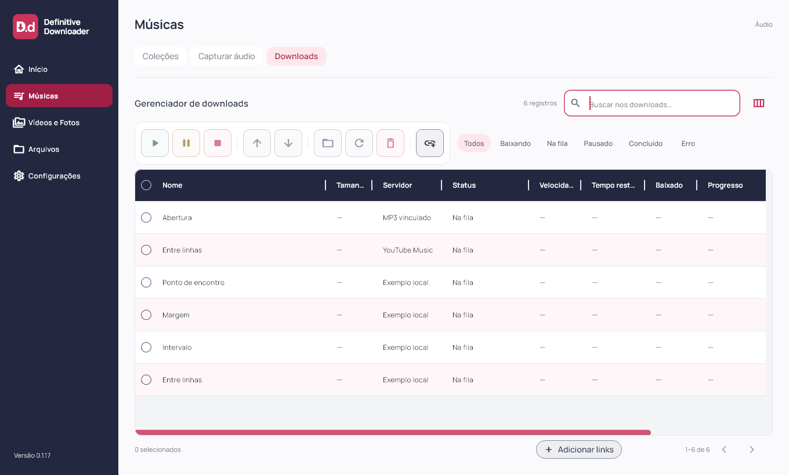
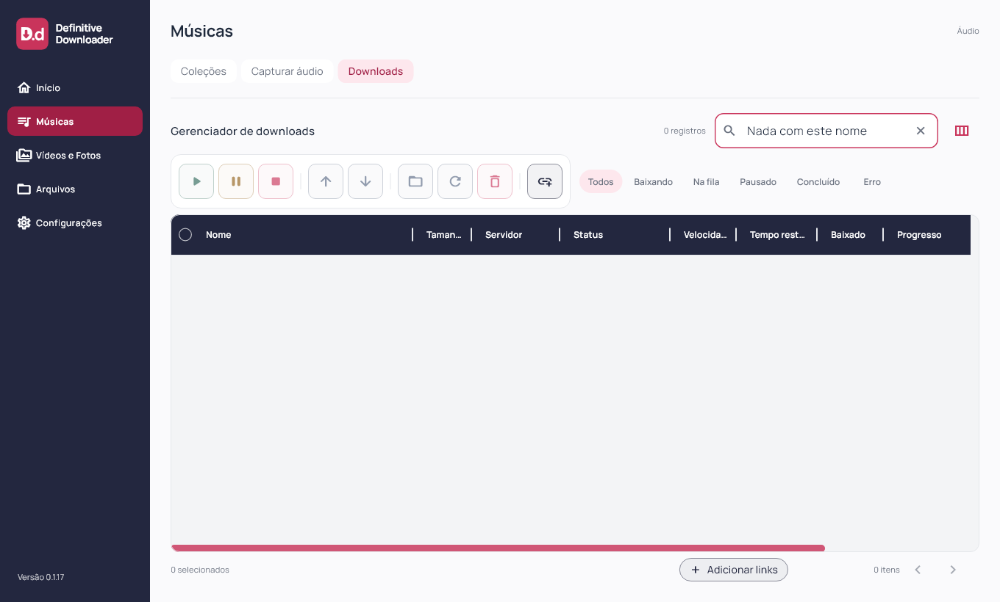
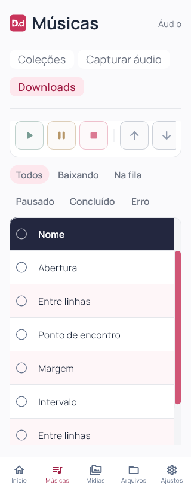

# Definitive Downloader 0.1.17

Refino da tabela solicitado em 03/11/2026. Flutter `0.1.17+18`; instalador deriva a versão do pubspec.

Downloads ganha área útil: em telas largas, pesquisa fica ao lado do título, filtros ao lado dos controles e paginação na linha inferior. A coluna Nome aproveita largura disponível quando as colunas compactadas não preenchem a tabela; essa expansão de apresentação não sobrescreve as preferências persistidas. Texto das células em 12 px, mantendo reticências, tooltips e ajuste das colunas.

Cabeçalho azul-marinho com texto branco permanece fixo enquanto as linhas rolam. Linhas alternam branco e rosa suave, com destaque de hover e seleção. Barras framboesa de 10 px nas duas direções facilitam localizar a posição; a vertical permanece na borda visível mesmo quando a tabela tem rolagem horizontal.

Filtro musical sem resultados mantém o cabeçalho, o corpo vazio e a seleção de página desabilitada. O aviso estático de adicionar faixas foi removido. A indisponibilidade real da fila de vídeos/fotos continua informada.

Sem alteração de schema, matching, fontes, contas ou motor de transferência. Widgets Flutter compartilhados entre desktop e mobile; Android/iOS e o motor nativo mobile não foram validados nesta rodada. Capturas usam fixtures, sem novo download real de provedor.

## Validação e distribuição

Formatação de 88 arquivos, análise estática sem problemas, 91 testes Flutter aprovados e build Windows release concluído. Layouts a 1920×1080, 1360×820, 900×820, 900×600, 390×820 e 320×820 (texto 1,3× no último); inspeção visual desktop/mobile e filtro vazio. Testes com 40 linhas verificam cabeçalho imóvel durante rolagem em 1100 e 390 px, expansão de largura e seleção desabilitada no corpo vazio.

Instalador executado com saída 0 e aplicativo `0.1.17+18` aberto pela instalação local. Antes/depois: uma coleção, dez faixas, dez históricos, zero ativos, uma coleção bloqueada, schema 9 e `quick_check=ok`. Backup local anterior à instalação. Atalho da Área de Trabalho conferido.

101 arquivos de fontes/testes/assets idênticos ao staging compilado. Executável, `data/app.so`, ICO e worker idênticos por hash entre pacote e instalação. Worker preservado: SHA-256 `266B509F026A92827FA48E8335BF59865BB6B1B06552E56DB48276145D01D271`. ZIP com 247 arquivos verificado sem corrupção, bancos ou transferências parciais. Evidências locais e dados das contas não são publicados. Capturas de widgets e conferência de versão/processo são verificações separadas; sem automação visual nativa nesta rodada.

[Release v0.1.17](https://github.com/GustavoDevGTI/D.d---Definitive-Downloader/releases/tag/v0.1.17), com instalador Windows x64, ZIP portátil e `SHA256SUMS.txt`; releases anteriores preservadas. Instalador sem assinatura digital.

| Artefato | Bytes | SHA-256 |
| --- | ---: | --- |
| Definitive-Downloader-0.1.17-Setup-Windows-x64.exe | 75739195 | `8a30744ad0a93e70daf36a3b66db1453f7d25ebd21f58440b5e1bf7cb655e04b` |
| Definitive-Downloader-0.1.17-Portable-Windows-x64.zip | 99516490 | `8bc9eae7a4aef5074262a691a3a44a58e6e500f0bf7e80a68236518c12f3ffe8` |
