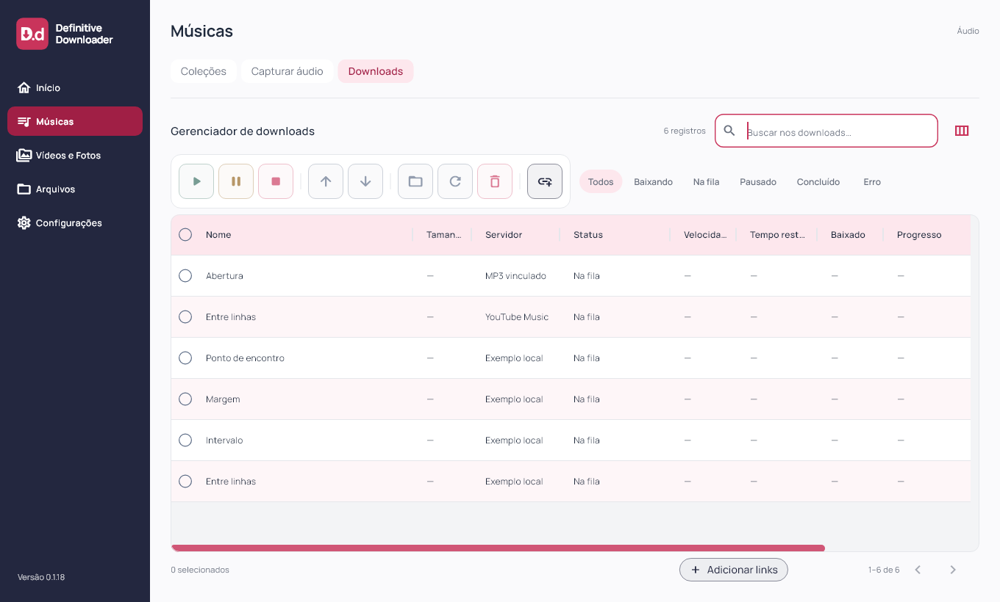
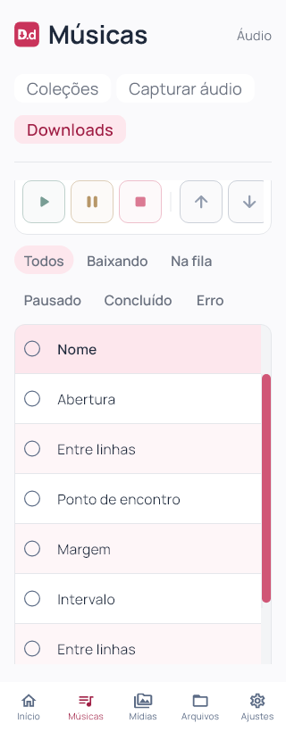

# Definitive Downloader 0.1.18

Cabeçalho claro solicitado em 03/11/2026. Flutter `0.1.18+19`; instalador deriva a versão do pubspec.

O cabeçalho da tabela de Downloads usa rosa suave oficial `#FDE7ED`, texto grafite `#1E293B` e contorno de seleção azul acinzentado `#5B6B85`. As divisórias suaves existentes ficam integradas ao tema claro. Preservados cabeçalho fixo, larguras, altura, linhas alternadas, barras framboesa, hover dos controles e tabela vazia nos filtros sem resultados.

Mudança apenas visual no componente Flutter compartilhado. Sem alteração de banco, contas, matching ou motor musical. Android/iOS não compilados/executados; motor mobile permanece pendente. Capturas com fixtures, sem nova autenticação ou download real.

## Validação e distribuição

88 arquivos formatados sem diferenças; análise estática sem problemas; 91 testes Flutter aprovados; build Windows release concluído. Capturas em 1920×1080, 1360×820, 900×820, 900×600, 390×820 e 320×820 (texto 1,3× no último); inspeção visual do cabeçalho em 1360 e 320 px. Testes existentes de rolagem e filtros preservados.

Instalador executado com saída 0; aplicativo `0.1.18+19` aberto pela instalação local e atalho da Área de Trabalho conferido. Banco preservado: uma coleção, dez faixas, dez históricos, zero ativos, uma coleção bloqueada, schema 9 e `quick_check=ok`; backup local anterior à instalação. Nenhuma sessão ou credencial inspecionada.

101 fontes/testes/assets idênticos ao staging compilado. Executável, `data/app.so`, ICO e worker idênticos entre pacote e instalação. Worker preservado: SHA-256 `266B509F026A92827FA48E8335BF59865BB6B1B06552E56DB48276145D01D271`. ZIP com 247 arquivos verificado sem corrupção, bancos ou transferências parciais. Evidências locais e dados das contas fora da publicação. Capturas de widgets e versão/processo conferidos separadamente; sem automação visual nativa.

[Release v0.1.18](https://github.com/GustavoDevGTI/D.d---Definitive-Downloader/releases/tag/v0.1.18), com instalador Windows x64, ZIP portátil e SHA256SUMS.txt. Releases anteriores preservadas; instalador sem assinatura digital.

| Artefato | Bytes | SHA-256 |
| --- | ---: | --- |
| Definitive-Downloader-0.1.18-Setup-Windows-x64.exe | 75733910 | `8372afc53d3c45394f00d37807127d940310399ac6c3021a5d2b5361914174e9` |
| Definitive-Downloader-0.1.18-Portable-Windows-x64.zip | 99516459 | `a226c66bd54974b4b9246b004f01e88b5d27f5868b74cc0dc0147f209c94e161` |
