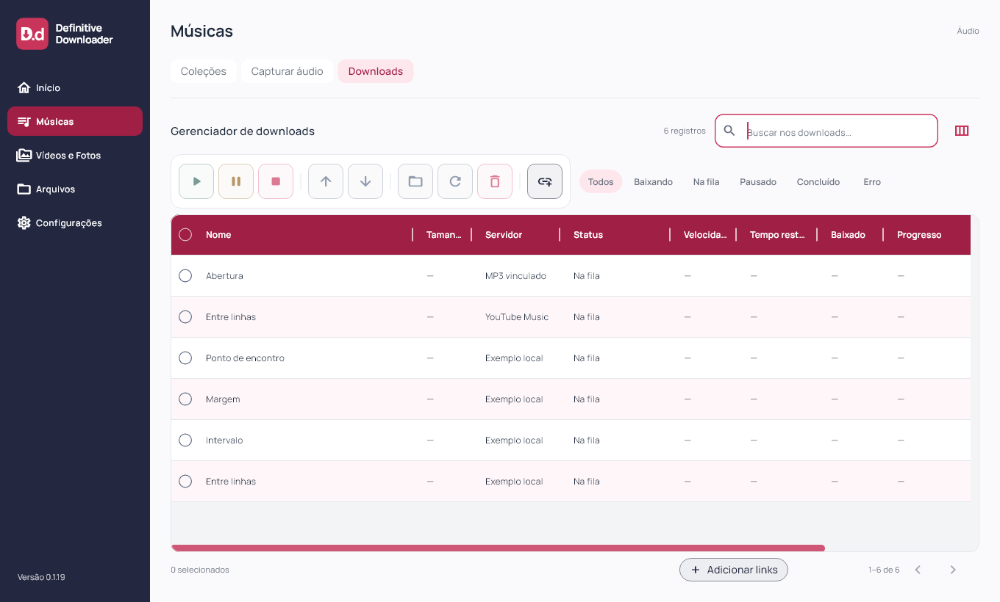

# Definitive Downloader 0.1.19

Correção das divisórias de Downloads e cabeçalho vinho solicitados em 03/11/2026. Flutter `0.1.19+20`; instalador deriva a versão do pubspec.

Arrastar uma divisória para qualquer lado redistribui espaço entre as duas colunas vizinhas. As outras divisórias e a largura total permanecem estáveis enquanto a vizinha tiver espaço. Quando ela chega ao mínimo, o arraste ainda pode ampliar a tabela, com rolagem horizontal, em vez de travar. O gesto parte das larguras efetivamente exibidas e atualiza o conjunto de uma vez: a expansão automática de Nome deixa de compensar o arraste em tabelas compactadas.

Os limites consideram os mínimos das duas colunas e o máximo de 1200 px. Ao atingir um limite, inverter o movimento responde imediatamente. Setas de teclado, acessibilidade e duplo clique respeitam esses limites; o arraste destaca a divisória com foco. A última coluna é ajustada pela divisória à sua esquerda; a borda externa sem coluna vizinha não tem alça. Restaurar colunas mantém os valores padrão globais. Larguras continuam persistidas ao terminar o gesto, sem migração ou redefinição automática das preferências.

O cabeçalho usa vinho oficial `#A01F45`, igual ao botão Músicas selecionado, com texto e divisórias claros. A caixa de seleção do cabeçalho fica branca com marca vinho quando selecionada. Esse pedido posterior substitui o cabeçalho rosa claro da 0.1.18. Linhas alternadas, filtros vazios e rolagem permanecem.

Implementação Flutter compartilhada entre desktop/mobile. Sem mudanças em matching, contas, playlist, fila ou motor musical. Capturas usam fixtures; sem download real novo. Android/iOS e motor nativo mobile não foram validados nesta rodada.

## Validação e distribuição

88 arquivos formatados; análise estática sem problemas; 93 testes Flutter aprovados; build Windows release concluído. Novos testes em 1100 e 390 px arrastam a mesma divisória nos dois sentidos, conferem deslocamento visual, largura recebida pela vizinha, estabilidade das demais colunas e resposta imediata ao inverter após o limite. Também verificam crescimento da tabela quando a vizinha chega ao mínimo.

Layouts a 1920×1080, 1360×820, 900×820, 900×600, 390×820 e 320×820 (texto 1,3× no último), com inspeção visual em 1360 e 320 px. Capturas de widgets e versão/processo conferidos separadamente; sem automação visual nativa.

Instalador executado com saída 0, aplicativo `0.1.19+20` aberto pela instalação local e atalho da Área de Trabalho conferido. Banco preservado: uma coleção, dez faixas, dez históricos, zero ativos, uma coleção bloqueada, schema 9 e `quick_check=ok`; backup local anterior à atualização. Sessões e credenciais não inspecionadas.

101 fontes/testes/assets idênticos ao staging compilado. Executável, `data/app.so`, ICO e worker idênticos entre pacote e instalação. Worker preservado: SHA-256 `266B509F026A92827FA48E8335BF59865BB6B1B06552E56DB48276145D01D271`. ZIP com 247 arquivos verificado sem corrupção, bancos ou transferências parciais. Evidências locais e dados das contas fora da publicação.

[Release v0.1.19](https://github.com/GustavoDevGTI/D.d---Definitive-Downloader/releases/tag/v0.1.19), com instalador Windows x64, ZIP portátil e SHA256SUMS.txt; releases anteriores preservadas. Instalador sem assinatura digital.

| Artefato | Bytes | SHA-256 |
| --- | ---: | --- |
| Definitive-Downloader-0.1.19-Setup-Windows-x64.exe | 75729356 | `eae4591d21b38f70e20dfdcdf241234bd48962e5db9ca51aaecf418be249a8df` |
| Definitive-Downloader-0.1.19-Portable-Windows-x64.zip | 99516977 | `02e7c35aff60d9d9aff7220c181ab09d0353f0a881a3b6603afb0530e3fa8cb2` |
