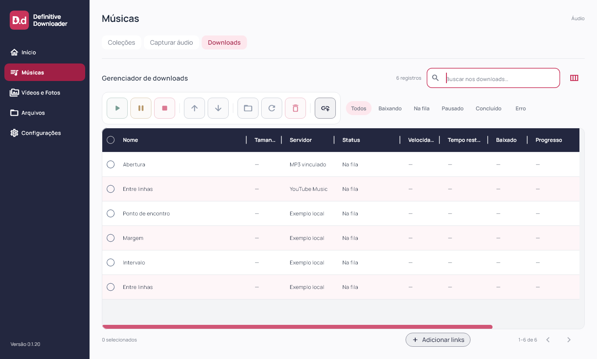
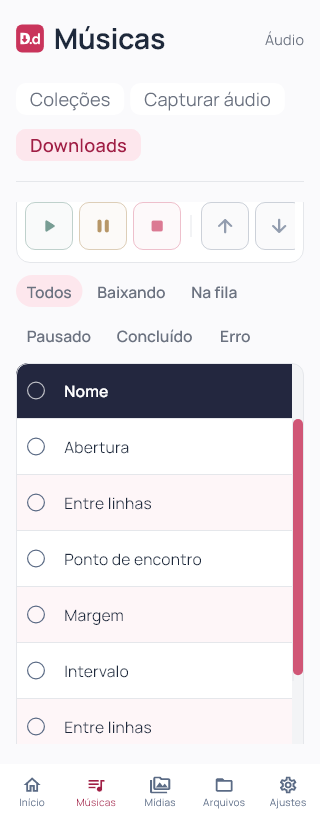

# Definitive Downloader 0.1.20

Retorno ao cabeçalho azul-marinho solicitado em 03/11/2026. Flutter `0.1.20+21`; instalador deriva a versão do pubspec.

Cabeçalho de Downloads restaurado para o azul-marinho oficial `#23273F`, com texto e divisórias claros. Seleção do cabeçalho usa fundo branco e marca azul-marinho. Preservados ajustes de colunas nos dois sentidos, larguras salvas, cabeçalho fixo, filtros vazios, linhas alternadas e barras framboesa.

Mudança visual no componente Flutter compartilhado, sem alteração de schema, contas, matching, fila ou motor musical. Android/iOS e motor mobile não validados nesta rodada. Capturas com fixtures, sem download real novo ou autenticação.

## Validação e distribuição

88 arquivos formatados sem diferenças; análise estática sem problemas; 93 testes Flutter aprovados; build Windows release concluído. Layouts a 1920×1080, 1360×820, 900×820, 900×600, 390×820 e 320×820 (texto 1,3× no último); inspeção visual em 1360 e 320 px.

Instalador executado com saída 0 e aplicativo `0.1.20+21` aberto pela instalação local; atalho da Área de Trabalho conferido. Antes/depois: uma coleção, dez faixas, dez históricos, zero ativos, uma coleção bloqueada, schema 9 e `quick_check=ok`. Backup local anterior à instalação. Sessões e credenciais não inspecionadas.

101 fontes/testes/assets idênticos ao staging compilado. Executável, `data/app.so`, ICO e worker idênticos por hash entre pacote e instalação. Worker preservado: SHA-256 `266B509F026A92827FA48E8335BF59865BB6B1B06552E56DB48276145D01D271`. ZIP com 247 arquivos verificado sem corrupção, bancos ou transferências parciais. Evidências locais e dados das contas fora da publicação. Capturas de widgets e conferência de versão/processo separadas; sem automação visual nativa.

[Release v0.1.20](https://github.com/GustavoDevGTI/D.d---Definitive-Downloader/releases/tag/v0.1.20), com instalador Windows x64, ZIP portátil e SHA256SUMS.txt. Releases anteriores preservadas; instalador sem assinatura digital.

| Artefato | Bytes | SHA-256 |
| --- | ---: | --- |
| Definitive-Downloader-0.1.20-Setup-Windows-x64.exe | 75737436 | `92a52699519314b228ca7ef747de3cc356ae7f971ebfeb7e01f4c295d80f0934` |
| Definitive-Downloader-0.1.20-Portable-Windows-x64.zip | 99516939 | `606416222b4ffe2a06883a66412d982745162cc475f994cf66fdf8bf253258e1` |
