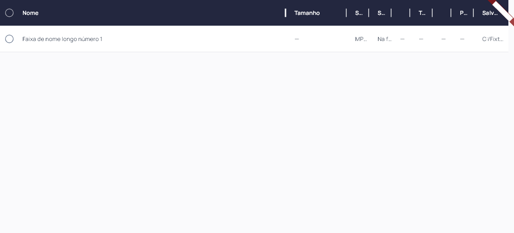
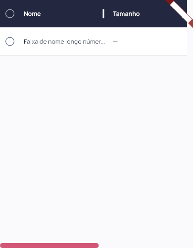

# Definitive Downloader 0.1.21

Correção do bloco claro na divisória solicitada em 03/11/2026. Flutter `0.1.21+22`; instalador deriva a versão do pubspec.

O foco aplicado ao iniciar o arraste pintava a área de toque da divisória de rosa claro, cobrindo um retângulo do cabeçalho. A área agora permanece transparente; apenas a linha muda de 2 px para 3 px, branca sobre o cabeçalho azul-marinho. O foco continua disponível após o gesto para ajuste com as setas; duplo clique, limites e persistência permanecem.

Regressão reproduzida antes da correção por amostragem do pixel de fundo durante arraste em 1100 e 390 px: esperado azul-marinho, encontrado rosa claro. O teste agora verifica o fundo durante o gesto e após soltar, além dos contratos existentes de ida/volta, limites e crescimento da tabela. Capturas usam fixtures; nenhuma nova transferência real ou autenticação.

Componente Flutter compartilhado entre desktop/mobile. Sem alteração de banco, fila, matching, contas ou worker. Android/iOS e motor mobile não validados nesta rodada.

## Validação e distribuição

88 arquivos formatados; análise estática sem problemas; 93 testes Flutter aprovados; build Windows release concluído. Layouts a 1920×1080, 1360×820, 900×820, 900×600, 390×820 e 320×820 (texto 1,3× no último). Inspeção visual adicional do arraste em 1100 px e do foco após soltar em 390 px. As capturas abaixo são testes isolados de widget, com marcador de debug; não são downloads de plataforma.

Instalador executado com saída 0 e aplicativo `0.1.21+22` aberto pela instalação local; atalho da Área de Trabalho conferido. Antes/depois: uma coleção, dez faixas, dez históricos, zero ativos, uma coleção bloqueada, schema 9 e `quick_check=ok`. Backup local anterior à instalação. Sessões e credenciais não inspecionadas.

101 fontes/testes/assets idênticos ao staging compilado. Executável, `data/app.so`, ICO e worker idênticos por hash entre pacote e instalação. Worker preservado: SHA-256 `266B509F026A92827FA48E8335BF59865BB6B1B06552E56DB48276145D01D271`. ZIP com 247 arquivos verificado sem corrupção, bancos ou transferências parciais. Evidências locais e dados das contas fora da publicação. Capturas de widgets e conferência de versão/processo separadas; sem automação visual nativa.

[Release v0.1.21](https://github.com/GustavoDevGTI/D.d---Definitive-Downloader/releases/tag/v0.1.21), com instalador Windows x64, ZIP portátil e SHA256SUMS.txt. Releases anteriores preservadas; instalador sem assinatura digital.

| Artefato | Bytes | SHA-256 |
| --- | ---: | --- |
| Definitive-Downloader-0.1.21-Setup-Windows-x64.exe | 75743937 | `68a5d8eb2beec9e035c263b29878b5b3596d088107f619e7b6c0314541bc4049` |
| Definitive-Downloader-0.1.21-Portable-Windows-x64.zip | 99516975 | `8670195fd2e346abb484f17cf66175e6a88082739ad9979c24671a6f2b80f7b0` |
