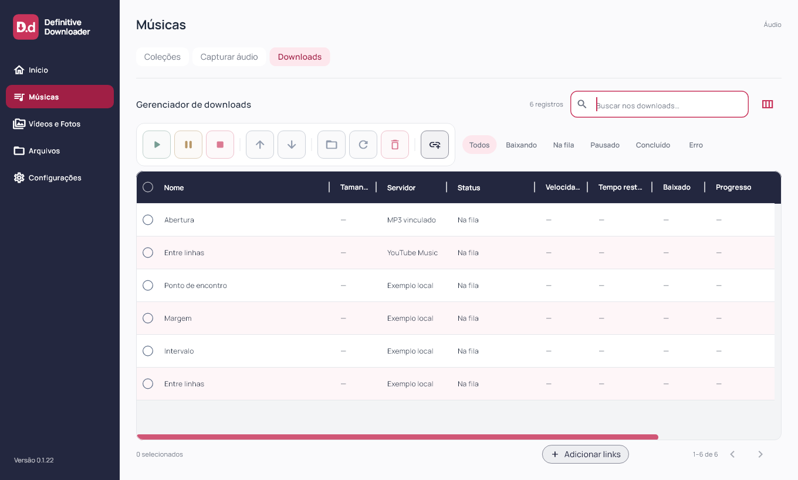
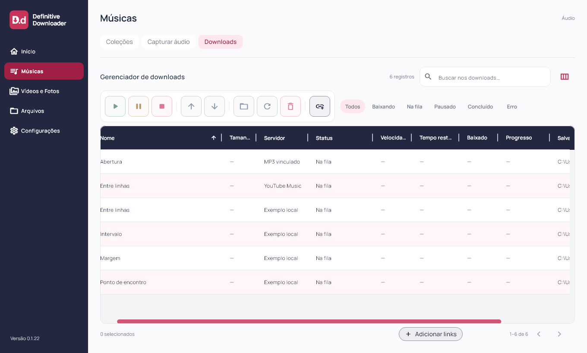

# Definitive Downloader 0.1.22

Ordenação de Downloads e ponta do cabeçalho solicitadas em 03/11/2026. Flutter `0.1.22+23`; instalador deriva a versão do pubspec.

Clique em Nome, Servidor, Status ou Salvar em ordena a visualização por essa coluna. Novo clique na mesma coluna inverte o sentido; mudar de coluna começa no crescente. Seta no cabeçalho indica o sentido. Arrastar a divisória continua redimensionando, sem disparar ordenação. No momento, Tamanho, Velocidade, Tempo restante, Baixado e Progresso não oferecem ordenação: não há métricas persistidas adequadas para ela.

A consulta SQLite aplica a ordem antes do limite de 40 e do deslocamento de página, inclusive com filtro e busca. Ordenação usa enum fechado e desempate por coleção, posição e ID; não recebe expressão SQL do usuário. Nome considera o nome do arquivo quando presente e o título personalizado nos demais casos; Servidor usa o rótulo da fonte; Salvar em considera a pasta do arquivo ou destino configurado. Comparação textual ignora caixa usando Dart, sem promessa de ordenação linguística por idioma. Status segue o ciclo aguardando, pronto, baixando, concluído, erro. Ao ordenar, volta à primeira página e limpa a seleção; a ordem fica na sessão, preservada durante busca/filtros e paginação.

A ordem da playlist, repetições, prioridade e execução da fila permanecem intactas. O padrão ao abrir continua por prioridade/posição. Nenhuma migração ou gravação é feita pela ordenação.

Uma faixa azul-marinho atrás da área reservada à barra vertical completa o cabeçalho até a borda direita, inclusive em filtros vazios. Foco discreto das divisórias e demais tratamentos da tabela preservados.

Núcleo Flutter/Dart compartilhado. Capturas usam fixtures; sem nova autenticação ou download real. Android/iOS e motor mobile não validados nesta rodada.

## Validação e distribuição

88 arquivos formatados; análise estática sem problemas; 96 testes Flutter aprovados; build Windows release concluído. Novos testes cobrem 45 ocorrências em duas páginas, direção crescente/decrescente, estabilidade de empates, valores exibidos de nome/fonte/pasta, status, busca/filtro e preservação de posição/prioridade. Widgets verificam alternância de seta e ausência de clique de ordenação durante arraste; amostragem de pixel confirma azul na ponta direita em 1100 e 390 px.

Integração da interface com controlador e SQLite validada por clique real de widget em 1360 e 390 px, conferindo retorno à primeira página, limpeza da seleção e inversão do sentido. Layouts a 1920×1080, 1360×820, 900×820, 900×600, 390×820 e 320×820 (texto 1,3× no último); inspeção visual de crescente desktop e decrescente mobile. Capturas de widgets e versão/processo conferidos separadamente; sem automação visual nativa.

Instalador executado com saída 0 e aplicativo `0.1.22+23` aberto pela instalação local; atalho da Área de Trabalho conferido. Antes/depois: uma coleção, dez faixas, dez históricos, zero ativos, uma coleção bloqueada, schema 9 e `quick_check=ok`. Backup local anterior à instalação. Sessões e credenciais não inspecionadas.

101 fontes/testes/assets idênticos ao staging compilado. Executável, `data/app.so`, ICO e worker idênticos por hash entre pacote e instalação. Worker preservado: SHA-256 `266B509F026A92827FA48E8335BF59865BB6B1B06552E56DB48276145D01D271`. ZIP com 247 arquivos verificado sem corrupção, bancos ou transferências parciais. Evidências locais e dados das contas fora da publicação.

[Release v0.1.22](https://github.com/GustavoDevGTI/D.d---Definitive-Downloader/releases/tag/v0.1.22), com instalador Windows x64, ZIP portátil e SHA256SUMS.txt. Releases anteriores preservadas; instalador sem assinatura digital.

| Artefato | Bytes | SHA-256 |
| --- | ---: | --- |
| Definitive-Downloader-0.1.22-Setup-Windows-x64.exe | 75750153 | `f53865ca83d6faebfca58dee7cccb212989302bf298eb6ac8c1e76c777cebbdb` |
| Definitive-Downloader-0.1.22-Portable-Windows-x64.zip | 99537300 | `a596bc06a89b34aa2c78b8c6b7037abe4cc0edbe044435121f6024770dfc4592` |
