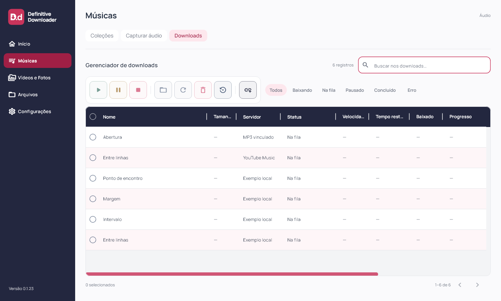
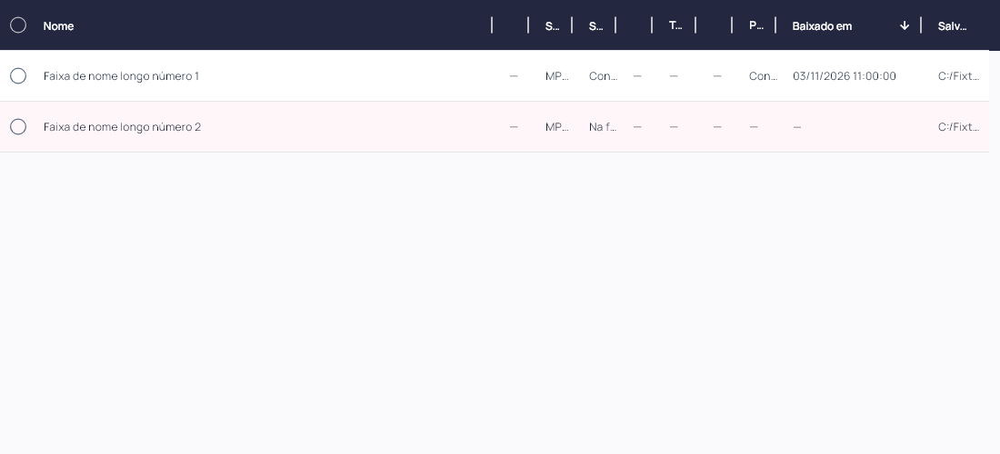
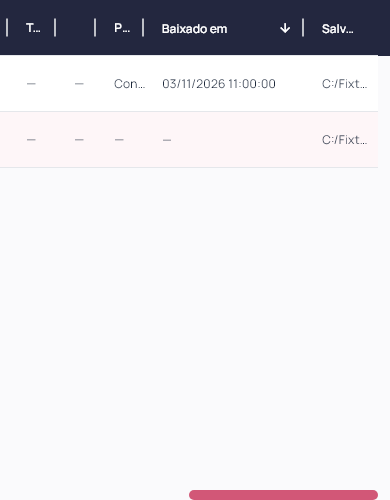

# Definitive Downloader 0.1.23

Barra compacta, reset da tabela e data de conclusão solicitados em 03/11/2026. Flutter `0.1.23+24`; instalador deriva a versão do pubspec.

Downloads mantém apenas o ícone Adicionar links na barra; removido o botão duplicado no rodapé musical. Setas de prioridade e seu separador foram removidos, sem espaço reservado. Resetar tabela fica no grupo de Abrir pasta, Tentar novamente e Remover. A barra tem oito ícones e preserva tooltips, hover e rolagem horizontal mobile. O antigo ícone Restaurar colunas junto à busca foi substituído pelo reset completo.

Resetar tabela restaura larguras padrão persistidas, limpa busca e timer pendente, filtros, ordenação, seleção e página, além de reiniciar as duas rolagens. Sem excluir coleção, faixa, arquivo ou histórico; execução e prioridades existentes não mudam. Falha ao salvar larguras continua informada.

Baixado em mostra data e hora locais do registro de conclusão do arquivo atual no histórico. A consulta relaciona ocorrência, caminho e estado concluído, sem multiplicar linhas ou ocultar a data se o histórico foi apenas escondido. SQLite CURRENT_TIMESTAMP é interpretado como UTC; registros ISO com fuso são respeitados. Não se usa horário de importação nem o relógio atual para preencher ausências.

Primeiro clique em Baixado em exibe os mais recentes; outro clique mostra os mais antigos. Ordenação acontece antes da paginação, com desempate pelo ID do histórico no mesmo sentido. Sem registro fica —, sempre ao final. A data corresponde ao primeiro registro de conclusão daquele arquivo no histórico: novas gravações no mesmo caminho não substituem esse registro. Dados antigos migrados preservam a data registrada na migração, pois o horário real anterior não está disponível; não se reconstrói uma cronologia inexistente. Sem mudança de schema ou regravação de histórico.

Componente Flutter/Dart compartilhado. Android/iOS e motor mobile não validados nesta rodada. Capturas com fixtures; sem nova autenticação ou download real de provedor.

## Validação e distribuição

88 arquivos formatados; análise estática sem problemas; 100 testes Flutter aprovados; build Windows release concluído. Testes de reset verificam retorno das larguras persistidas, busca/timer, filtros, ordenação, seleção, página e duas rolagens, preservando contagens de registros e concluídos. Barra verifica oito botões em linha, único Adicionar links, ausência de setas de prioridade e ausência do antigo ícone junto à busca.

Datas testadas em 45 ocorrências e duas páginas, nos dois sentidos, com desconhecidos ao final, empate pela sequência do histórico e leitura UTC de CURRENT_TIMESTAMP. Histórico escondido mantém a data na fila. Widgets verificam data, ausência e inversão em 1100 e 390 px. Layouts completos a 1920×1080, 1360×820, 900×820, 900×600, 390×820 e 320×820 (texto 1,3× no último); inspeção visual desktop/mobile e da nova coluna. Capturas de widgets e conferência de versão/processo separadas; sem automação visual nativa.

Instalador executado com saída 0 e aplicativo `0.1.23+24` aberto pela instalação local; atalho da Área de Trabalho conferido. Antes/depois: uma coleção, dez faixas, dez históricos, zero ativos, uma coleção bloqueada, schema 9 e `quick_check=ok`. Backup local anterior à instalação. Sessões e credenciais não inspecionadas.

101 fontes/testes/assets idênticos ao staging compilado. Executável, `data/app.so`, ICO e worker idênticos por hash entre pacote e instalação. Worker preservado: SHA-256 `266B509F026A92827FA48E8335BF59865BB6B1B06552E56DB48276145D01D271`. ZIP com 247 arquivos verificado sem corrupção, bancos ou transferências parciais. Evidências locais e dados das contas fora da publicação.

[Release v0.1.23](https://github.com/GustavoDevGTI/D.d---Definitive-Downloader/releases/tag/v0.1.23), com instalador Windows x64, ZIP portátil e SHA256SUMS.txt. Releases anteriores preservadas; instalador sem assinatura digital.

| Artefato | Bytes | SHA-256 |
| --- | ---: | --- |
| Definitive-Downloader-0.1.23-Setup-Windows-x64.exe | 75753921 | `e120c0b627cd553846ce86c1f47a19c5739fba35583d1075bca5cd46296d40d1` |
| Definitive-Downloader-0.1.23-Portable-Windows-x64.zip | 99537149 | `b953aaf8e98f6489864229a6fe625007284dc76431999e1f1b38d17eeff9ccd1` |
