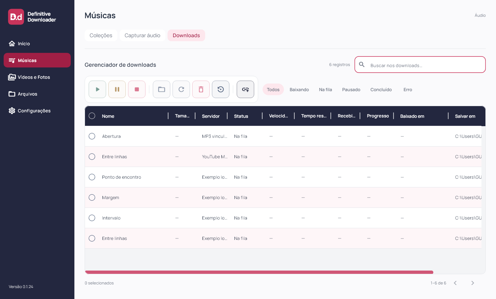
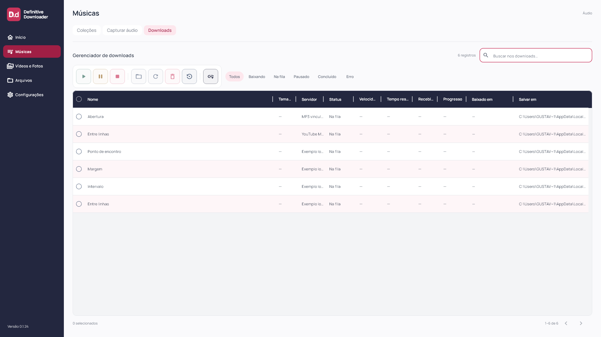
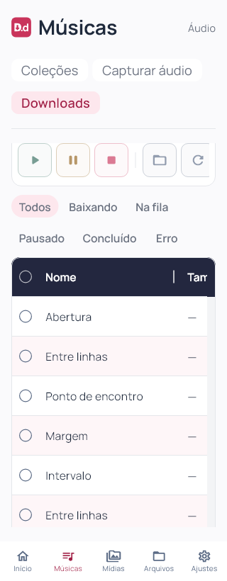

# Definitive Downloader 0.1.24

Compactação das colunas solicitada em 03/11/2026. Flutter `0.1.24+25`; instalador deriva a versão do pubspec.

Larguras padrão: seleção 40, Nome 200, Tamanho 74, Servidor 88, Status 96, Velocidade 88, Tempo restante 100, Recebido 80, Progresso 92 e Baixado em 150 px. Somam 1008 px antes de Salvar em, que mantém 230 px. A 1360 px desktop, todas as colunas até Baixado em ficam inicialmente no viewport; a pasta pode permanecer além da borda. Em 1920 px, Nome aproveita a sobra e todas as colunas podem aparecer. Telas menores/mobile mantêm rolagem horizontal e redimensionamento, sem reduzir a fonte de 12 px.

Recebido substitui o rótulo Baixado para distinguir quantidade de bytes da data Baixado em. Tooltip explicita a unidade e a indisponibilidade da medição; os valores continuam —. Nenhuma nova métrica foi implementada ou simulada.

Resetar tabela passa a usar as larguras compactas. A aplicação mantém as preferências existentes ao iniciar; a alteração das larguras do perfil Windows atual será feita uma única vez nesta entrega, com backup, em atendimento ao pedido explícito de compactar a tabela atual. Não há limpeza automática, migração de schema ou alteração de arquivos, matching, fila e contas.

Componente Flutter/Dart compartilhado. Capturas com fixtures; sem nova autenticação ou download real. Android/iOS e motor mobile não validados nesta rodada.

## Validação e distribuição

88 arquivos formatados; análise estática sem problemas; 100 testes Flutter aprovados; build Windows release concluído. Testes geométricos verificam que seleção e todas as colunas até Baixado em estão integralmente no viewport inicial a 1360 e 1920 px; a 1360, Salvar em pode ultrapassar a borda. Layouts completos a 1920×1080, 1360×820, 900×820, 900×600, 390×820 e 320×820 (texto 1,3× no último), com inspeção visual em 1360, 1920 e 320 px.

Instalador executado com saída 0 e aplicativo `0.1.24+25` aberto pela instalação local; atalho da Área de Trabalho conferido. Aplicadas uma única vez as dez larguras compactas ao perfil atual, com backup anterior e evidência local das larguras antes/depois. Demais preferências preservadas; nenhum mecanismo de reset foi adicionado à inicialização.

Antes/depois: uma coleção, dez faixas, dez históricos, zero ativos, uma coleção bloqueada, schema 9 e `quick_check=ok`. Sessões e credenciais não inspecionadas. 101 fontes/testes/assets idênticos ao staging compilado. Executável, `data/app.so`, ICO e worker idênticos por hash entre pacote e instalação. Worker preservado: SHA-256 `266B509F026A92827FA48E8335BF59865BB6B1B06552E56DB48276145D01D271`. ZIP com 247 arquivos verificado sem corrupção, bancos ou transferências parciais. Evidências locais e dados das contas fora da publicação. Capturas de widgets e conferência de versão/processo separadas; sem automação visual nativa.

[Release v0.1.24](https://github.com/GustavoDevGTI/D.d---Definitive-Downloader/releases/tag/v0.1.24), com instalador Windows x64, ZIP portátil e SHA256SUMS.txt. Releases anteriores preservadas; instalador sem assinatura digital.

| Artefato | Bytes | SHA-256 |
| --- | ---: | --- |
| Definitive-Downloader-0.1.24-Setup-Windows-x64.exe | 75750530 | `3d7c1f8ceeb065e0f189613b6e2a90d9ebe3786379bb5b982e8559ae9fc38ef7` |
| Definitive-Downloader-0.1.24-Portable-Windows-x64.zip | 99537578 | `967eb89a63c75f5469da3a31949539f75246ffc9ac2f128974ce3d152e41663b` |
