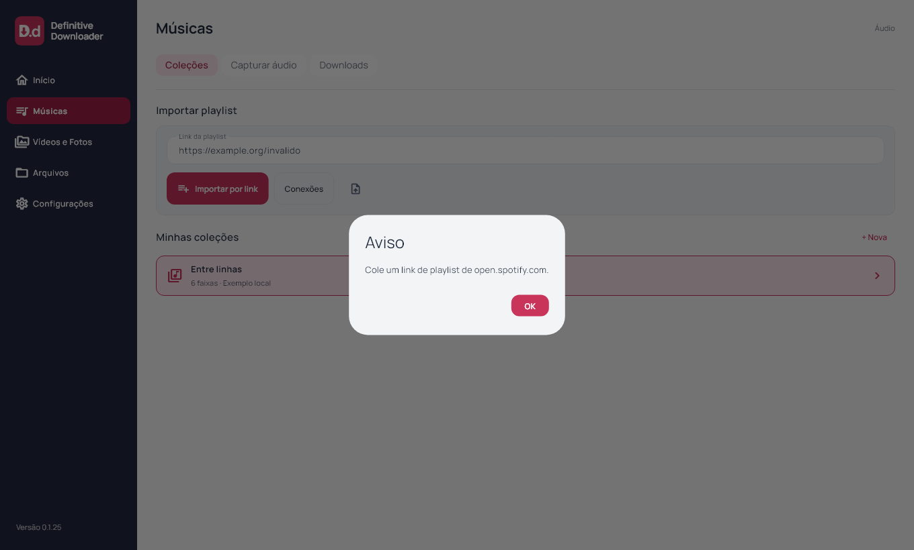
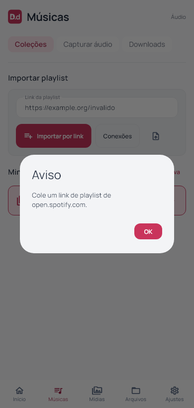
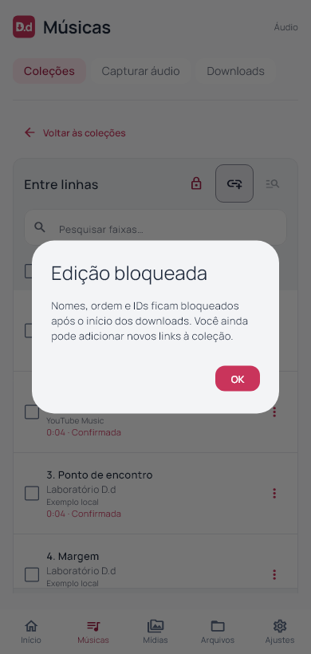
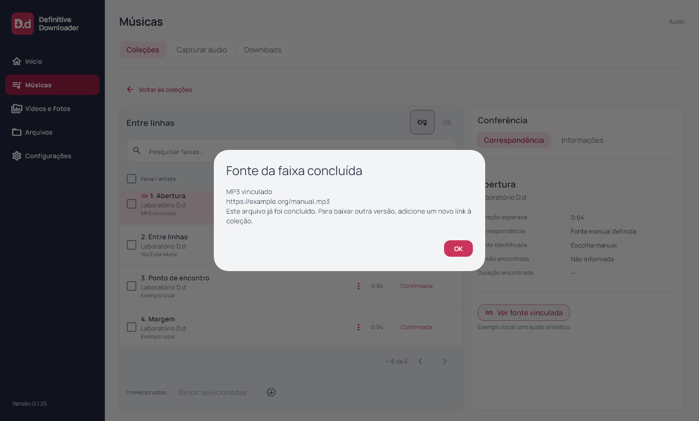
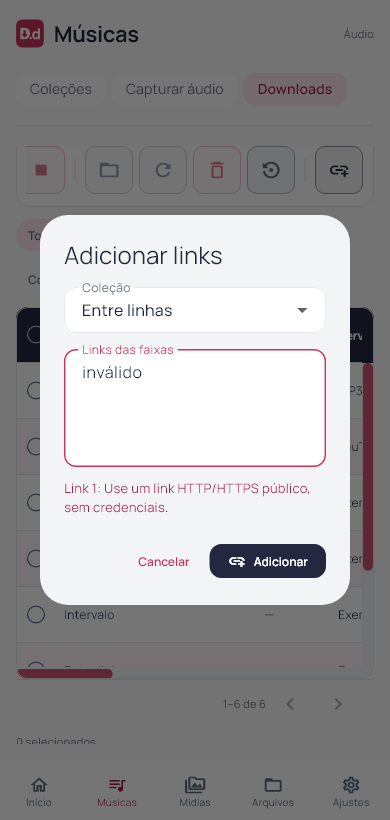

# Definitive Downloader 0.1.25

Avisos e controles de Coleções solicitados em 03/11/2026. Flutter `0.1.25+26`; instalador deriva a versão do pubspec.

Avisos e resultados concluídos da biblioteca e do workspace aparecem em AlertDialog central com OK. `AppNoticeHost` apresenta após o frame e reconhece a mensagem exibida, evitando repetição em cada refresh. Mensagem idêntica em nova tentativa volta a aparecer. Enquanto um aviso está aberto, o último resultado pendente espera o fechamento; a apresentação não empilha avisos automaticamente. Progresso de importação/preparação/download permanece contextual e não gera popups por faixa ou atualização de rede.

Erros de Adicionar links e Editar faixa já ficam em formulários modais: são reconhecidos ali para evitar um segundo popup com a mesma mensagem. Validações de campos continuam no formulário; indisponibilidades e erros associados à faixa continuam visíveis na conferência, pois são necessários à decisão. Removidas as faixas de aviso ociosas no rodapé principal, Downloads e Arquivos.

A caixa no cabeçalho de faixas passa a selecionar/desmarcar todas as ocorrências do filtro, inclusive outras páginas, com estado parcial. Removidos o botão redundante Selecionar todas e a linha Seleção múltipla. Linhas ainda têm seleção individual. O método relacional existente preserva repetições e aplica o filtro; não se carrega a coleção inteira na UI.

O cadeado é um botão com tooltip e popup explicando o bloqueio de nomes, ordem e IDs após o início. Não destrava a coleção nem contorna a regra. Adição de novos links permanece disponível pelas ações existentes.

Informar/editar link manual recebe botão contornado vinho; remover vínculo e marcar revisão usam contorno da paleta. Estados ocupados continuam desabilitados por suas regras reais. Para faixas concluídas, a conferência oferece Ver fonte vinculada em vez de controles de edição bloqueados; o popup informa a fonte e orienta adicionar outra ocorrência se desejar outra versão. Ouvir prévia foi removido, pois a reprodução ainda não está integrada; nenhuma reprodução foi implementada ou simulada.

Implementação Flutter compartilhada, sem mudança de schema, arquivo, fila, fonte ou autenticação. Android/iOS e motor musical mobile não validados nesta rodada. Capturas com fixtures, sem download real novo.

## Validação e distribuição

90 arquivos formatados; análise estática sem problemas; 102 testes Flutter aprovados; build Windows release concluído. Novos testes do host verificam aviso central em 1360 e 390 px, ausência de popup durante progresso, resultado posterior aguardando fechamento, repetição legítima e ausência de duplicação no refresh.

Integração por widgets cobre importação inválida repetida, erro dentro de Adicionar links sem segundo popup, seleção parcial/todas/desmarcar, explicação do cadeado e consulta de fonte concluída sem editar o vínculo. O teste relacional existente cobre seleção de 85 ocorrências em várias páginas. Layouts a 1920×1080, 1360×820, 900×820, 900×600, 390×820 e 320×820 (texto 1,3× no último), com inspeção visual dos popups desktop/mobile e botões da conferência. Fixtures de bloqueio/conclusão são apenas apresentação, sem arquivo real ou download de plataforma. Capturas de widgets e conferência de versão/processo separadas; sem automação visual nativa.

Instalador executado com saída 0 e aplicativo `0.1.25+26` aberto pela instalação local; atalho da Área de Trabalho conferido. Antes/depois: uma coleção, dez faixas, dez históricos, zero ativos, uma coleção bloqueada, schema 9 e `quick_check=ok`. Backup local anterior à instalação. Sessões e credenciais não inspecionadas; larguras compactas da entrega anterior preservadas.

103 fontes/testes/assets idênticos ao staging compilado. Executável, `data/app.so`, ICO e worker idênticos por hash entre pacote e instalação. Worker preservado: SHA-256 `266B509F026A92827FA48E8335BF59865BB6B1B06552E56DB48276145D01D271`. ZIP com 247 arquivos verificado sem corrupção, bancos ou transferências parciais. Evidências locais e dados das contas fora da publicação.

[Release v0.1.25](https://github.com/GustavoDevGTI/D.d---Definitive-Downloader/releases/tag/v0.1.25), com instalador Windows x64, ZIP portátil e SHA256SUMS.txt. Releases anteriores preservadas; instalador sem assinatura digital.

| Artefato | Bytes | SHA-256 |
| --- | ---: | --- |
| Definitive-Downloader-0.1.25-Setup-Windows-x64.exe | 75761932 | `68ea4166da8b2e5e90ca03e34ed5f9994e8448f47a5dea3183af95dc33c50700` |
| Definitive-Downloader-0.1.25-Portable-Windows-x64.zip | 99543056 | `adce37112101fee9b0cb6ba25b19ab1ca1fe6e8a014dc041e578d381b6b04291` |
