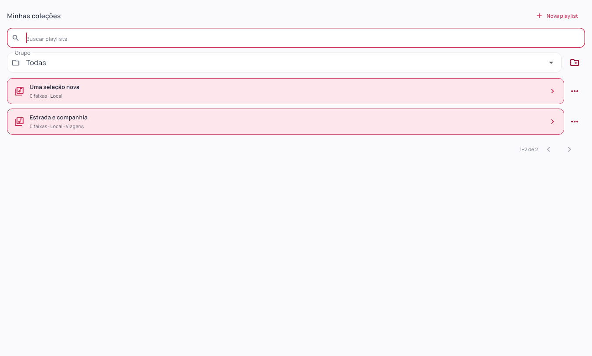
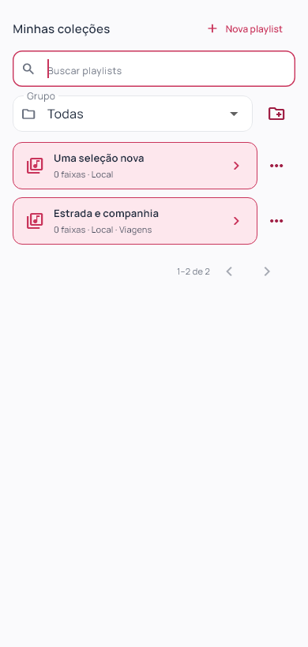

# Definitive Downloader 0.1.26

Gestão local de playlists solicitada em 04/11/2026: criar, renomear, buscar e agrupar. Flutter `0.1.26+27`; instalador deriva a versão do pubspec.

## Comportamento

Em Músicas → Coleções, Nova playlist cria uma coleção local vazia e abre sua lista de faixas. Adicionar links continua usando o diálogo existente, com as mesmas fontes, regras de correspondência e limites. Importar por link e CSV permanecem disponíveis. Criar uma playlist local não cria uma playlist em uma conta externa.

A busca por nome considera todas as playlists antes da paginação, com comparação sem distinção entre maiúsculas e minúsculas, inclusive letras acentuadas. Busca e grupo podem ser combinados. A listagem retorna 30 itens por página, com total real; um filtro novo retorna à primeira página. Consultas antigas não substituem o resultado do filtro atual.

Grupos têm um único nível; cada playlist pertence a um grupo ou fica Sem grupo. O seletor oferece Todas as playlists, Sem grupo e grupos nomeados com contagem real. Gerenciar grupos permite criar e, com um grupo selecionado, renomear ou remover. A remoção pede confirmação e apenas desvincula as playlists; preserva faixas e arquivos. Limite explícito de 100 grupos, nomes de até 80 caracteres e unicidade sem distinção de caixa. Playlists aceitam nomes de até 160 caracteres, inclusive nomes repetidos.

O menu de cada playlist oferece Renomear playlist e Mover para grupo. Essas ações alteram a organização da biblioteca local. Renomear a coleção não renomeia faixas nem desbloqueia sua edição após o início dos downloads. O nome utilizado na pasta de download fica preservado; nenhum arquivo ou pasta existente é renomeado ou movido, e futuras faixas continuam na mesma pasta da coleção. Ações de alteração ficam indisponíveis durante as operações ocupadas da biblioteca. Validações permanecem no próprio formulário modal.

## Design e arquitetura

Lista vertical, menus contextuais e formulários curtos, mantendo a paleta oficial: rosa `#C9345B`, vinho `#A01F45`, rosa suave `#FDE7ED`, grafite `#1E293B`, fundo `#FAFAFC` e bordas `#E5E7EB`. Manrope e componentes compartilhados mantêm a identidade. Sem mural de cartões, sombras decorativas ou novas explicações permanentes. Campos e ações adaptados às larguras mobile, com seleção de grupos limitada em altura e formulários roláveis.

Módulo `organization` separado em domínio, repositório, controlador e apresentação. SQL e validações persistentes ficam fora dos widgets. Schema 10 acrescenta `collection_groups`, vínculo opcional `collections.group_id` com `ON DELETE SET NULL`, índice por grupo e `storage_name`. A migração preserva os nomes anteriores das pastas. Não há escrita remota, deduplicação, combinação de playlists, movimentação de mídia ou mudança no motor musical.

Núcleo Dart e interface Flutter compartilhados entre desktop e mobile. Testes de widgets em tamanhos mobile não comprovam execução nativa Android/iOS; essas plataformas e o motor musical mobile continuam pendentes de validação própria. Ensaios desta entrega são locais e sintéticos, sem novo download ou autenticação de provedor.

## Validação e distribuição

98 arquivos Dart formatados; análise estática sem problemas; 110 testes Flutter aprovados; build Windows release concluído. Testes relacionais cobrem paginação de 65 playlists, busca com letras acentuadas e consulta literal, nomes inválidos/duplicados, grupos únicos e limite, preservação de ocorrências, bloqueio, fonte, histórico e nome da pasta; migração v9→v10 repetida; resultados concorrentes e recuperação de página após mover. Fixtures antigas reconstruídas também sem as colunas do schema 10, validando as migrações desde v2, v5, v6, v7 e v8.

Testes da interface cobrem criação local, validação no formulário, renomeação de playlist, busca/limpeza, criação/mudança/renomeação/remoção de grupo em 1360, 390 e 320 px (texto 1,3× no último). Regressão de layout a 1920×1080, 1360×820, 900×820, 900×600, 390×820 e 320×820. Capturas inspecionadas em desktop e mobile; fixtures sintéticas separadas da biblioteca instalada. Verificações de widgets e processo nativo são evidências distintas; sem automação visual nativa ou execução Android/iOS.

Instalador executado com saída 0; aplicativo `0.1.26+27` aberto da instalação local e atalho da Área de Trabalho conferido. Backup SQLite local antes da instalação. Migração instalada de schema 9 para 10, `quick_check=ok`, zero downloads ativos, preservando integralmente por hash as colunas anteriores: uma coleção, dez faixas, dez históricos, dez preferências, noventa candidatos e dez últimas tentativas. Nenhuma credencial inspecionada e nenhuma redefinição de preferências.

113 fontes/testes/assets idênticos ao staging compilado. Executável, `data/app.so`, ICO e worker idênticos por SHA-256 entre pacote e instalação. Worker preservado: `266B509F026A92827FA48E8335BF59865BB6B1B06552E56DB48276145D01D271`. ZIP de 247 arquivos validado sem corrupção, bancos, credenciais ou transferências parciais. Evidências e backup mantidos localmente, fora da publicação.

[Release v0.1.26](https://github.com/GustavoDevGTI/D.d---Definitive-Downloader/releases/tag/v0.1.26), com instalador Windows x64, ZIP portátil e SHA256SUMS.txt. Releases anteriores preservadas; instalador sem assinatura digital.

| Artefato | Bytes | SHA-256 |
| --- | ---: | --- |

| Definitive-Downloader-0.1.26-Setup-Windows-x64.exe | 75768418 | `5bbe6a1a23518c6e8f015f93f17469d2f26bf212fbbacc68532bb34c7dc2841c` |
| Definitive-Downloader-0.1.26-Portable-Windows-x64.zip | 99556036 | `c74a1fb93606e3097dc1f2af778637f40104a7f6b7b22f310da41267bffcb009` |
