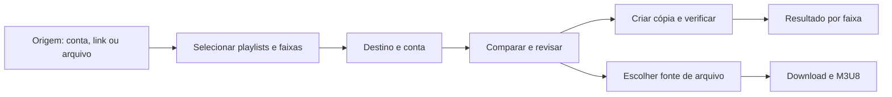

# Transferência de playlists integrada ao Definitive Downloader

Pesquisa realizada em 27/10/2026. Referência de produto: TuneMyMusic. Esta entrega registra estudo e desenho da próxima feature; não adiciona transferência autenticada ao executável atual.

Escopo ampliado pelo usuário: além de transferir, incluir compartilhamento, cópia de segurança, geração de playlists com IA e organização. O detalhamento e a sequência proposta estão em [FERRAMENTAS_DE_PLAYLISTS.md](FERRAMENTAS_DE_PLAYLISTS.md).

## 1. Conclusão

O Definitive Downloader pode incorporar um fluxo próprio de importação, correspondência e recriação de playlists, compartilhando regras em Dart entre desktop e mobile. Recomendo implementar esse módulo dentro da nossa interface. Integrações com cada plataforma devem ter capacidades verificadas individualmente, sem depender de incorporar o site de terceiros.

O fluxo de correspondência também pode alimentar o download, mas cada fonte precisa demonstrar separadamente que fornece um arquivo completo. Recriar uma playlist não produz os MP3s dessa playlist.

## 2. O que foi confirmado sobre o TuneMyMusic

A documentação do serviço descreve leitura da biblioteca, procura de correspondências por título, artista, álbum e ISRC, e reconstrução no destino. O relatório aponta faixas ausentes. Isso explica o mecanismo observável; não revela o algoritmo interno, seus pesos ou sua implementação. [Fonte: Spotify → YouTube Music](https://www.tunemymusic.com/pt/transfer/spotify-to-youtube-music).

O serviço aceita plataforma, texto, arquivo ou URL como origem e oferece transferência, backup e sincronização. Informa usar APIs oficiais na maioria das integrações, com exceções declaradas. Não se deve assumir que as permissões dessas integrações estão disponíveis para um aplicativo recém-criado. [Fonte: apresentação do serviço](https://www.tunemymusic.com/pt).

A ajuda descreve autorização das contas, seleção de playlists, escolha do destino e início da cópia. A origem é preservada. Há relatório exportável de faixas que não foram transferidas. [Fonte: ajuda](https://www.tunemymusic.com/pt/help).

Não encontrei documentação pública suficiente para contratar e incorporar uma API/SDK do TuneMyMusic. Isso não comprova que uma oferta comercial inexista. Qualquer integração com o motor deles exigiria verificar contrato, preço, permissões, callbacks e suporte; não é dependência assumida para o Definitive Downloader. Não foram reaproveitados identificadores de cliente, tokens ou endpoints internos do serviço.

## 3. Ensaio no navegador, sem conta

Foi percorrido o assistente público em `/pt/transfer`, pela opção **Texto livre**, com estas entradas públicas de exemplo:

```text
Rick Astley - Never Gonna Give You Up
Daft Punk - One More Time
Rick Astley - Never Gonna Give You Up
```

O site exibiu etapa 2/4, seleção por playlist e faixa, `3/3 selecionado` e manteve as três ocorrências na seleção. A etapa 3/4 mostrou plataformas de destino, compartilhamento e exportação. A opção de arquivo abriu seleção TXT/CSV. O teste parou antes de exportar ou escrever em uma conta.

**Alcance:** comprova o fluxo de entrada e seleção, inclusive a repetição nessa tela. Não comprova que o destino preserva repetições, que o matching foi correto ou que uma transferência remota foi concluída. O botão Spotify não avançou na sessão observada; autenticação não foi testada.

Evidência: [captura da seleção](images/tunemymusic-selecao.jpg) e [registro do ensaio](evidencias/tunemymusic-observacoes.md).

## 4. Experiência proposta para o Definitive Downloader

Adicionar **Transferir** à navegação. Utilizar a mesma tipografia, tons claros e tabela do app atual. Uma operação por vez, com etapas textuais discretas e uma ação principal no rodapé.



| Etapa | Conteúdo e comportamento |
| --- | --- |
| Origem | Plataforma, conexão da conta e playlist, ou CSV/texto. Um link identifica a playlist; não garante autorização nem acesso à lista completa. |
| Seleção | Total lido versus esperado, ordem e repetições. Não permitir confirmar uma origem parcial como se estivesse completa. |
| Destino | Mostrar apenas funções realmente habilitadas para a integração e a conta conectada. Nome da nova playlist e privacidade explícita; começar com cópia privada quando o destino permitir. |
| Conferência | Tabela com gravação original, candidata no destino, versão, duração e motivo da correspondência. Filtros para revisar, ausentes e indisponíveis. Mostrar apenas casos incertos por padrão. |
| Revisão final | Resumo do que será criado, quantos itens serão enviados e quais ficarão de fora. O usuário pode voltar e corrigir antes de iniciar a escrita. |
| Resultado | Link da playlist criada, itens confirmados, ausentes, erros e operações sem confirmação; relatório CSV e opção de tentar apenas o que não foi concluído. |

No mobile, reutilizar os mesmos estados e casos de uso em Dart; exibir conferência em tela própria. Desktop pode manter o painel lateral. Login utiliza o navegador/fluxo de sistema e retorna ao app; o restante da experiência é nativo.

Exemplo ilustrativo: de 100 ocorrências, 91 seguras, seis em revisão e três ausentes. Confirmar as 91 deve produzir resultado parcial explícito, com as outras nove preservadas no relatório. Esses números são um cenário de projeto, não uma medição do TuneMyMusic.

## 5. Viabilidade por plataforma em outubro de 2026

| Plataforma/função | Evidência e decisão para o Definitive Downloader |
| --- | --- |
| Spotify: leitura autenticada | Development Mode exige Premium do proprietário do aplicativo e tem limite de cinco usuários autorizados. A leitura de itens nesse modo é restrita a playlists próprias ou em colaboração. Não prometer suporte a qualquer link público. [Quota modes](https://developer.spotify.com/documentation/web-api/concepts/quota-modes), [migração de fevereiro](https://developer.spotify.com/documentation/web-api/tutorials/february-2026-migration-guide). |
| Spotify: distribuição pública | Extended Quota depende de aprovação. Os critérios publicados incluem organização constituída, serviço lançado e pelo menos 250 mil usuários ativos mensais. Logo, acesso amplo é uma dependência comercial a resolver, não apenas adicionar um botão de login. [Requisitos oficiais](https://developer.spotify.com/documentation/web-api/concepts/quota-modes). |
| Spotify: versões da integração | O limite inicial de um Client ID por desenvolvedor foi elevado a 25 em julho; as quotas de desenvolvimento passaram a ser compartilhadas por conta de desenvolvedor. Não usar um tutorial antigo como especificação definitiva. [Changelog de julho](https://developer.spotify.com/documentation/web-api/references/changes/july-2026). |
| Deezer: pesquisa | A versão atual do Definitive Downloader já consultou catálogo público e recebeu prévia. Isso não comprova conexão de conta nem escrita de playlist. |
| Deezer: escrita | Um Community Manager da Deezer informou em outubro de 2025 que a criação de novos acessos para particulares havia sido desabilitada. Não foi obtido um App ID próprio nem validada reabertura nesta pesquisa. Tratar a escrita como acesso pendente de confirmação com a plataforma. [Resposta da Deezer](https://en.deezercommunity.com/features-feedback-44/api-auth-impossible-80857?postid=254887). |
| YouTube: escrita | A Data API documenta criação de playlists e inclusão de vídeos, com autorização. É o destino mais concreto para um piloto após configurar credenciais próprias e quotas. [Criar playlist](https://developers.google.com/youtube/data/reference/rest/v3/playlists/insert), [adicionar item](https://developers.google.com/youtube/data/reference/rest/v3/playlistItems/insert). |
| YouTube Music | O Google documenta transferência por ferramentas como TuneMyMusic. Isso não concede ao Definitive Downloader a integração específica deles. A capacidade da Data API do YouTube não comprova equivalência com catálogo, biblioteca ou disponibilidade no Music; validar na conta e nos clientes pretendidos antes de anunciar suporte. [Ajuda do YouTube Music](https://support.google.com/youtubemusic/answer/14729358?hl=pt-BR). |

Para Spotify Development Mode, usar o formato atual de itens e operações aplicável ao modo: `GET /playlists/{id}/items`, não congelar o antigo contrato `/tracks`. Preservar o modo/perfil de acesso no adapter e aceitar metadados opcionais. A leitura pública parcial existente fica como recurso limitado, não como substituta da importação autenticada. A falha TLS já observada no cliente Dart precisa ser resolvida sem desativar certificados. [Migração oficial](https://developer.spotify.com/documentation/web-api/tutorials/february-2026-migration-guide).

### Orçamento do piloto YouTube

A documentação atual separa 100 buscas `search.list` por dia e 10.000 unidades para os demais métodos; criar playlist e inserir cada item custam 50 unidades por chamada. A quota pertence ao projeto, não a cada usuário. [Quotas](https://developers.google.com/youtube/data/determine_quota_cost), [busca](https://developers.google.com/youtube/data/reference/rest/v3/search/list).

Estimativa nossa para 100 faixas inéditas: 100 buscas e pelo menos 5.050 unidades para criar uma playlist e inserir seus itens, mais leituras/verificação. Duas playlists desse tamanho excederiam 10.000 unidades mesmo sem contar verificação. O piloto precisa de limite, cache permitido, retomada por quota e estimativa antecipada; ampliar depende da quota efetivamente concedida. Não assumir processamento ilimitado.

## 6. Correspondência: regras propostas

O motor recebe a gravação solicitada e candidatos do destino, e devolve uma decisão explicável. As regras abaixo são nossas, não uma reprodução do algoritmo do TuneMyMusic.

1. Procurar identificador de gravação, como ISRC, quando ambos os catálogos realmente o fornecerem.
2. Buscar por título e artistas, enriquecendo com álbum, duração e versão quando disponíveis. Resolver artistas principais e participações separadamente.
3. Normalizar pontuação e acentos para comparação, preservando a informação original.
4. Penalizar versões conflitantes: live/ao vivo, remix, acústico, cover, instrumental, remaster, clean/explicit e aceleração. Identificador coincidente ajuda, mas não elimina conflitos de metadados.
5. Comparar o melhor candidato com o segundo: resultados muito próximos pedem revisão. Duração ausente deve ser desconhecida, nunca zero interpretado como evidência.
6. Aceitar automaticamente somente o conjunto de regras calibrado em casos verificados. Pontuação é uma heurística, não uma probabilidade ou promessa de acerto.
7. Registrar a decisão por ocorrência e por destino. Compartilhar uma busca não elimina duas ocorrências iguais da playlist.

Começar com revisão assistida dos casos incertos. Avaliar uma amostra com versões difíceis antes de habilitar aceitação em lote. Ausência no catálogo e falha de rede são estados diferentes; uma busca interrompida não vira “música não encontrada”.

## 7. Encaixe na base Flutter atual

| Base existente | Evolução necessária |
| --- | --- |
| `Collection`/`Track`, CSV, SQLite e posições | Reutilizar a importação; acrescentar identidade da plataforma, revisão da origem e completude verificável. |
| `Candidate` e `TrackMatcher` | Hoje a candidata está ligada a prévia e o matching é heurístico. Separar gravação de catálogo de fonte de arquivo; manter várias candidatas/decisões por destino. Rever ISRC conflitante e versões antes de aceitação automática. |
| `DeezerCatalog` | Manter consulta como adapter de catálogo. Um `previewUrl` não habilita escrita de playlist nem arquivo completo. |
| `LibraryController` | Conservar biblioteca/download; novo controlador de transferência com seu próprio estado, sem concentrar todo o fluxo neste arquivo. |
| `TrackStatus` e fila local | Não reutilizar `downloading/completed` para indicar escrita remota. Transferência precisa de estados próprios e confirmação por ocorrência. |
| `PlaylistExporter` | Reutilizar exportação local; acrescentar relatório de transferência separado da M3U8 de arquivos efetivamente salvos. |

Organização proposta, a criar quando cada parte for implementada:

```text
lib/features/connections/   # conexão e desconexão de contas
lib/features/providers/     # adapters e capacidades por plataforma
lib/features/matching/      # busca e decisão compartilhadas
lib/features/transfers/
  domain/                   # plano, ocorrência e resultado
  application/              # preparar, executar e reconciliar
  data/                     # persistência das operações
  presentation/             # fluxo nativo adaptativo
```

Interfaces pequenas: ler uma página de ocorrências; procurar candidatas; preparar um plano; executar o plano autorizado; acompanhar ou cancelar. Recursos como inserção em lote, preservação de repetições e leitura de confirmação são capacidades de cada adapter, não pressupostos globais.

### Persistência proposta

Acrescentar migrações incrementais, sem reescrever o banco atual e sem serializar a playlist inteira:

| Registro | Informação essencial |
| --- | --- |
| Conexão de conta | Plataforma, identificador estável da conta, escopos e referência ao cofre. Tokens ficam fora do SQLite. |
| Snapshot de origem | Coleção, referência remota, revisão quando existir, total esperado, total lido e completude. |
| Candidata | Plataforma, ID da gravação, metadados relevantes e validade da consulta conforme a política do provedor. |
| Decisão | Ocorrência, destino, candidata, motivos, revisão e versão das regras. |
| Trabalho de transferência | Snapshot, conta de destino, nova playlist remota, estado e progresso. |
| Item de transferência | Ocorrência de origem, posição planejada, ID escolhido no destino e resultado confirmado. |
| Tentativa de escrita | Operação, momento, resultado e indicação de resposta incerta, sem segredos ou payloads integrais. |

Manter paginação de 40 na UI e lotes locais de 100. O tamanho dos lotes remotos depende da plataforma. Consultas e atualizações seguem parametrizadas e limitadas.

## 8. Execução confiável

- Criar uma nova playlist por padrão. Alterar uma existente, remover faixas ou espelhar exclusões exige um modo próprio com revisão explícita.
- Validar conta, permissões, quota e completude da origem antes da escrita. Congelar a seleção; se a origem mudar durante a leitura, detectar por revisão quando possível ou informar a limitação.
- Paralelizar buscas com limite baixo e ajustável por plataforma. Serializar a escrita de cada playlist para manter a ordem.
- Gravar checkpoint por ocorrência. Retomar somente itens pendentes ou reconciliados como não aplicados.
- Tratar POST sem resposta como **resultado desconhecido**. A operação pode ter sido aplicada no servidor. Ler o destino e reconciliar ocorrências/posições antes de repetir; não presumir suporte a chave de idempotência.
- Se a criação da playlist perder a resposta e o destino não oferecer reconciliação inequívoca, pedir resolução dentro do app em vez de criar sucessivas cópias pelo mesmo nome.
- Preservar repetições quando o destino permitir; se a plataforma rejeitar duplicatas, apresentar a incompatibilidade antes de executar.
- Respeitar `Retry-After`, distinguir limitação temporária de quota esgotada e limitar tentativas. Interrupção não apaga itens já aceitos pelo destino.
- Verificar ao final a sequência confirmada e emitir resultado parcial quando houver ausência, omissão ou incerteza. Cancelar não significa desfazer a escrita remota.

A primeira versão dessa feature depende do app aberto. Continuar com o processo fechado, sincronizar entre dispositivos ou executar agendas no servidor exige outro ciclo de produto e infraestrutura.

## 9. Contas e execução em desktop/mobile

Adotar Authorization Code com PKCE e navegador de sistema onde a plataforma suportar. Spotify recomenda PKCE para clientes que não conseguem manter um segredo; Google documenta o fluxo para apps instalados e restringe agentes de login embutidos. [Spotify PKCE](https://developer.spotify.com/documentation/web-api/tutorials/code-pkce-flow), [Google OAuth nativo](https://developers.google.com/identity/protocols/oauth2/native-app).

Compartilhar os casos de uso em Dart; separar retorno OAuth e cofre por sistema. Windows, Android e iOS precisam de configuração de cliente/redirect adequada. Não incluir segredo de aplicação privilegiado no executável ou APK. Um provedor que exigir segredo deve usar backend próprio com acesso aprovado, não um segredo escondido no Dart.

No Google, manter um projeto por ambiente e clientes OAuth próprios para desktop, Android e iOS conforme os alvos atendidos. No Spotify, configurar os retornos e identificadores desses alvos no cadastro adequado. O callback de loopback definido para Windows não é contrato de autenticação do mobile. O roteiro detalhado está em [CONFIGURACAO_DAS_CONTAS_DE_TESTE.md](CONFIGURACAO_DAS_CONTAS_DE_TESTE.md).

A tela Conexões deve permitir conferir a conta, desconectar e solicitar revogação quando suportada. Não guardar tokens em logs, CSV ou backups de playlists. O fluxo de leitura pede apenas leitura; escrita solicita a capacidade necessária quando o usuário escolhe o destino. Identificadores de contas são específicos por provedor e devem seguir as orientações atuais desse provedor.

## 10. Ordem recomendada de entrega

1. **Conferência em lote:** fluxo nativo com CSV/texto, destino de catálogo, casos incertos e relatório. Sem apresentar isso como transferência remota concluída. Reutilizar o exemplo para testar ordem e repetições.
2. **Conexão Spotify:** criar cliente próprio, confirmar acesso de desenvolvimento e autenticar localmente quando retomada essa etapa pelo usuário. Importar integralmente uma playlist própria conhecida. Resolver TLS antes de alegar funcionamento nessa máquina.
3. **Primeira cópia real:** Spotify autorizado ou CSV → nova playlist privada no YouTube pela Data API. Configurar projeto Google, limites e consentimento. Comprovar leitura de volta, ordem, repetição e retomada sem duplicação.
4. **Compatibilidade YouTube Music:** verificar se as gravações/playlist do piloto aparecem e funcionam no Music; caso não, tratar uma integração Music específica como nova dependência. Não trocar os nomes YouTube e YouTube Music na UI.
5. **Deezer e outros destinos:** habilitar escrita somente com acesso próprio aprovado e testes completos. Pesquisa pública continua útil de forma independente.
6. **Download e sincronização:** consumir decisões revisadas no módulo de arquivos apenas para fontes com obtenção validada. Sincronização começa unidirecional e aditiva; espelhamento com exclusões fica para uma etapa posterior.

Cada integração deve exercitar o mesmo caso de uso em desktop e mobile, embora o executável Windows continue sendo o alvo atualmente entregue. Não tratar reutilização de Dart como comprovação automática de funcionamento mobile.

## 11. Critérios para considerar uma integração pronta

- Importação com total conferido; ausência de permissão não tratada como playlist vazia.
- Ordem e ocorrências repetidas verificadas no destino quando suportadas.
- Versões parecidas e nomes iguais de artistas diferentes não aceitos por engano na amostra de validação.
- Desconexão, negação de acesso, expiração, indisponibilidade, quota e resposta de escrita perdida cobertas.
- Reinício sem recriar itens já confirmados; relatório mantém os itens sem confirmação.
- Teste real pequeno com conta autorizada, distinto de fixtures, confirmado pela leitura do destino.
- UI e integração de sistema validadas no alvo anunciado.

Nesta pesquisa não foram criadas credenciais, conectadas contas nem escritas playlists remotas. A análise das capacidades acima é documental; os testes reais da versão anterior continuam registrados separadamente em `TESTES_SEM_CONTA.md`.
